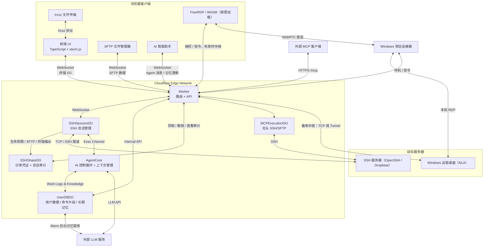

<div align="center">
  
  <p>在浏览器中使用 SSH 终端和 SFTP，通过 Cloudflare Workers 连接服务器。登录后可管理已保存服务器；启用 Windows 远程桌面的实例还可在同一标签页打开桌面。</p>
  <p><b>极致轻量 · 开箱即用 · 赛博朋克 UI</b></p>
  <p>
    <a href="https://github.com/newbietan/CloudSSH/stargazers"></a>
    <a href="https://afdian.com/a/newbietan" target="_blank"></a>
    <a href="LICENSE"></a>
    
    
    
  </p>
  <p>
    <a href="#highlights">核心优势</a> ·
    <a href="#features">功能特性</a> ·
    <a href="#quick-start">部署指南</a> ·
    <a href="#architecture">架构设计</a> ·
    <a href="CHANGELOG.md">更新日志</a> ·
    <a href="#contributors">贡献者</a> ·
    <a href="#sponsor">赞助支持</a> ·
    <a href="#special-thanks">特别感谢</a> ·
    <a href="#license">开源协议</a>
  </p>
  <p>
    <a href="README.md">简体中文</a> |
    <a href="README_en.md">English</a>
  </p>
</div>

> [!TIP]
> **CloudSSH** 利用 Cloudflare Workers 的 TCP Sockets 支持，在边缘节点实现 SSH 协议的解析与转发，提供低延迟的 Web 终端体验。

## 效果演示

> 想象一下，随时随地打开浏览器，就能以极具科技感的赛博朋克 UI 连接你的服务器，无需安装任何 SSH 客户端。

<div align="center">
  <a href="https://www.bilibili.com/video/BV1UgMt6UEdF" target="_blank" title="点击播放视频">
    
    <br/>
    
  </a>
  <p><sub>视频时长 19:48 · 演示 CloudSSH 完整使用流程</sub></p>
</div>

## 目录

<details>
<summary><b>点击展开完整目录</b></summary>

- [核心优势](#highlights)
- [核心特性](#features)
- [架构说明](#architecture)
- [快速部署](#quick-start)
  - [GitHub 绑定自动部署](#推荐通过-github-绑定自动部署)
    - [自动同步上游版本](#sync-upstream)
  - [可配置环境变量](#可配置环境变量)
  - [启用 Cloudflare Access 登录](#可选启用-cloudflare-zero-trust-access-登录)
  - [启用单管理员密码登录](#可选启用单管理员密码登录替代-github-oauth)
  - [配置 Turnstile](#可选配置-turnstile-人机验证)
  - [配置 GitHub OAuth](#可选配置-github-oauth-登录与服务器管理)
  - [Windows 远程桌面](#windows-rdp)
- [开发说明](#development)
  - [本地开发](#本地开发)
- [贡献者](#contributors)
- [赞助支持](#sponsor)
- [特别感谢](#special-thanks)
- [开源协议](#license)

</details>

<a id="highlights"></a>

## 核心优势

### 极致 Serverless

- **无需自建网关**：服务运行在 Worker 和使用 SQLite 的 Durable Objects 上；实际额度和费用取决于 Cloudflare 套餐。
- **边缘加速**：全球边缘网络就近接入，随时随地享受低延迟的 SSH 连接。

### 开箱即用

- **一键部署**：Fork 仓库后在 Cloudflare Dashboard 绑定 GitHub 即可自动构建部署，无需本地环境。
- **现代技术栈**：TypeScript + Vite + Tailwind CSS + xterm.js，兼顾性能与可维护性。

### 安全可靠

- **双段加密**：浏览器 ↔ Worker 走 HTTPS/WSS；Worker ↔ 服务器走完整 SSH-2.0 协议（Curve25519-SHA256/ECDH-NISTP256 密钥交换、AES-256-GCM/CTR 加密、HMAC-SHA2 完整性校验）。
- **主机指纹验证**：Ed25519/ECDSA P-256/P-384/P-521/RSA 签名校验，首次连接展示 SHA-256 指纹（TOFU）。兼容 Ed25519、RSA-SHA2-256/512 和 ECDSA P-256/P-384/P-521 OpenSSH 主机证书：检查证书签名、有效期、主机类型和关键限制，再以底层公钥验证 SSH 握手并保存稳定指纹。此模式仍是公钥 TOFU，不自动信任证书内的 CA，也不把 principals 当作已获 CA 授权的主机身份；尚不提供 CA 信任库。证书续签不改变同一公钥的指纹，实际公钥变更仍须明确确认。
- **加密私钥与 MFA**：连接表单与已保存服务器编辑器都支持粘贴私钥或选择本地文件（≤128 KiB，支持无后缀文件）。支持在浏览器内解锁 OpenSSH bcrypt/AES-CTR 与 PKCS#8 PBES2 私钥；口令不保存、不发送至 Worker，但解锁私钥仍由 Worker 用于签名。匿名连接默认不持久化解锁材料，保存服务器须单独同意。支持公钥成功后的显式 password 第二因素，保留现有 OTP 交互认证。范围、预算与真实互操作测试见 [SSH 兼容说明](docs/ssh-compatibility.md)。
- **多层防护**：IPv6/保留地址 SSRF + DNS 防重绑定、Worker 内存限流削峰、Turnstile 人机验证；已保存凭据在每用户 SQLite 中以 AES-256-GCM 加密存储。
- **会话隔离**：每个终端会话由独立 Durable Object 管理，活动 SSH TCP 连接使会话保持唤醒。
- **已保存凭据**：SSH 一键连接使用一次性票据，不向浏览器返回已保存的密码或私钥。Windows 远程桌面不同：仅在登录用户主动连接时，浏览器才取得保存的登录凭据供 FreeRDP 使用；设备列表不返回密码。

<a id="features"></a>

## 核心特性

<details>
<summary><b>点击展开查看完整功能特性列表（自研 SSH 协议栈、跳板链、一次性分享、在线 SFTP、AI 运维助手等）</b></summary>

- **纯 TypeScript SSH-2.0 实现**：完全自研的 SSH 协议栈，不依赖任何第三方 SSH 库，基于 Web Crypto API 实现全部加密操作。
- **多算法密钥交换**：支持 Curve25519-SHA256（优先）和 ECDH-NISTP256 两种 KEX 算法，适配各类 SSH 服务器（包括 Dropbear）。
- **可靠的密钥切换与分包处理**：逐包读取当前加密与认证状态，兼容服务端将 `SSH_MSG_NEWKEYS` 和首个加密包合并在同一 TCP 数据块中返回的情况。
- **IPv4/IPv6 双栈**：完整支持 IPv4 和 IPv6 地址连接，包括 IPv6 方括号格式自动处理。
- **多种认证方式**：支持标准 SSH 密码认证、RFC 4252 §5.2 `none` 无认证、RFC 4256 `keyboard-interactive` 多轮交互认证，以及 OpenSSH 格式的 Ed25519、ECDSA P-256/P-384/P-521 和 RSA 私钥认证。选择「无认证（none）」后仅提交用户名，不发送密码或私钥；服务器必须明确允许此方式，拒绝时不会回退其他认证。这不是空密码登录；用户名可能就是访问凭据，请勿泄露，并注意本机连接历史会保存用户名。密码模式允许留空并发送空密码；编辑已有密码时留空保留原值，勾选「设为空密码」才清空。交互认证支持直接回车提交空响应、零提示轮次、密码、OTP、多字段提示与公钥后的二次验证；服务器提示会在绑定当前连接的安全对话框中展示，已保存密码仅在用户明确选择后代填。RSA 默认使用 RSA-SHA2-256/512，只有显式兼容配置才允许旧 `ssh-rsa` SHA-1。
- **SSH 跳板机/堡垒机**：登录用户可以为已保存服务器选择另一台已保存服务器作为跳板。CloudSSH 使用标准 RFC 4254 `direct-tcpip` 通道逐层建立 SSH，不依赖远端安装 `ssh`、`nc` 或 `socat`；支持最多 3 级跳转，最终目标的终端、SFTP 与 AI Agent 均复用完整加密链路。每一跳独立认证和验证路径隔离的主机指纹。
- **Cloudflare 隧道（Zero Trust Tunnel）**：支持通过 Cloudflare Tunnel（cloudflared）直连无公网 IP、无开放端口的内网服务器（HomeLab、局域网主机等），无需设置或租用跳板机。底层采用官方标准 WebSocket Carrier 架构将 SSH 二进制帧直接穿透传输，支持可选的 Cloudflare Zero Trust Service Token（Client ID / Client Secret）鉴权保护。上层自研 SSH 协议栈、TOFU 指纹、SFTP 文件系统及 AI Agent 全量无缝复用。
- **一次性 SSH 分享**：登录所有者可主动为已保存的 SSH 服务器创建只能领取一次的链接。链接不含登录凭据；接收者能使用终端和 SFTP，不能使用 Agent 或 MCP。所有者可撤销分享，查看生命周期、SFTP 操作及终端输出审计。
- **防范中间人攻击 (TOFU)**：首次连接自动提取服务器 Host Key（SHA-256 指纹）并显示，支持 Ed25519/ECDSA/RSA 签名验证，并在本地及 API 持久化缓存已知主机指纹以防范二次连接的欺骗风险。
- **终端渲染**：xterm.js 在可用时使用 WebGL 加速。未确认输出积压超限时会关闭会话，不会无限缓存日志。
- **Herdr 等远端程序复制（OSC 52）**：在前台终端里照常复制，不需要额外授权。只有浏览器不允许直接写入时，才显示「复制到剪贴板」按钮；可用 `Alt+Shift+C` 聚焦按钮，再按 Enter。后台输出不会改写剪贴板，分享会话不启用。
- **可靠的终端剪贴板交互**：鼠标完成终端选区后自动复制，右键可直接粘贴；触摸设备通过「选择」进入选区模式，可拖动起止手柄精确调整、在屏幕上下边缘自动滚动历史，并通过独立的复制/取消操作栏结束选择；仅选择模式隔离原生长按菜单。粘贴使用独立按钮，浏览器无法读取剪贴板时提供不持久化、绑定当前会话的手动粘贴框（最多 65,536 字符，多行可能执行命令）。粘贴统一经过 xterm.js 原生输入管线，仅在远端应用启用 bracketed paste 模式时发送对应控制序列，并自动规范化换行，兼容 Vim 等交互式编辑器和普通 Shell。
- **触屏精细操作**：「更多」提供 12–18px 终端字号调整/自动模式（本机记忆）与当前标签操作；SFTP 支持显式打开、多选勾选、全选与清空，继续复用原有编辑、串行下载及批量删除。有文件传输时，主动关闭抽屉、切换标签/抽屉或返回连接页会先确认中断；断线与销毁仍立即清理，不提供后台传输。使用方式和真机验收边界见 [移动端交互说明](docs/mobile-ux.md)。
- **移动端 SSH**：终端适配软键盘与安全区，可通过快捷栏输入组合键、方向键和 Esc。从后台返回时会先检查 WebSocket，短暂断线可尝试恢复原 Shell；若需重新连接已保存服务器，则申请新票据。Shell 就绪前不发送终端输入。
- **个性化 UI 与液态分段切换器**：Theme V4 系统提供 Standard Dark、Standard Light、Cyberpunk 以及参考 macOS 26 液态玻璃质感打造的 Liquid Glass 四款内置主题。用户空间顶栏与终端操作区升级为悬浮玻璃灵动岛与液态分段切换器（Liquid Segmented Controls），将 SFTP、自定义命令与 AI Agent 抽屉整合为单极药丸胶囊，配备共享一维物理弹簧引擎（`spring.ts`，基于 Euler 数值积分）驱动的 3D 液态透镜滑块，提供丝滑的互斥展开与收起体验。指针聚光灯（Specular Spotlight）泛化至全主题（rAF 节流传导 CSS 变量，触屏设备自动跳过以省电），新增服务器卡片与 SFTP 列表交错入场动效、冷加载骨架屏（含完整 ARIA 无障碍标记）、全局键盘 `:focus-visible` 主题色焦点环，并修复多层阴影组合语法规范。V4 支持渐变/网格背景层（含读性遮罩与缓慢漂移动画）、扫描线/闪烁/辉光/噪点效果注册表、独立表面模糊与提饱和档位（`saturate(180%)` + 镜面内发光）与版式缩放，全量动效支持 `prefers-reduced-motion` 与 `data-ui-motion` 降级，主体风格间差异显著。背景漂移采用独立裁剪层与预绘制纹理的 `transform` 合成，减少主线程重绘而不削弱玻璃材质、模糊或光晕。配套 [GitHub Pages 主题编辑器](https://newbietan.github.io/CloudSSH/theme-editor/)可实时调整颜色、形状、密度、字体、阴影、动效、背景层、效果及按钮/输入框/卡片/标签页样式，并预览登录页、服务器列表、终端 + SFTP 和 AI Agent 面板。分段条默认常驻 5 项（4 款内置 + 1 款自定义 Custom），移除了独立的上传按钮。用户点击 Custom 时若未上传过主题将自动弹出管理模态框引导上传，已激活状态下再次点击 Custom 可打开管理弹窗进行多套主题管理（支持色块预览、切换生效、删除确认，最多保存 20 套自定义主题）。登录用户自动通过云端跨设备同步多主题库，匿名用户本地保存在当前浏览器。
- **本地字体与图标**：Material Symbols Outlined 与 JetBrains Mono 随项目分发，主站内联到单 HTML，主题编辑器使用同源字体，不再依赖 Google Fonts；普通构建不下载字体。这并非整站离线化，认证、SSH 等联网功能保持不变。来源、许可证与裁剪维护步骤见[字体本地化说明](docs/local-fonts.md)。
- **响应式服务器表单**：新增、编辑和克隆弹窗在宽屏采用双栏布局，名称/标签并排、连接/认证分栏；窄屏、短窗口与大字号下保留字段区滚动，标题和保存按钮始终可达。四个内置主题与自定义主题共用布局，服务器表单及匿名连接页均完整显示五位端口，并保留原生数字控件和端口校验。
- **SFTP 图形化文件管理**：集成完整的 SFTP v3 文件传输协议，提供图形化文件浏览器界面。列表使用父容器事件委托与选区差量更新，减少大目录下的重复监听器和 DOM 写入，保留完整列表与既有选择行为。工具栏支持路径面包屑分级导航（点击直达父级目录，点击空白切换绝对路径文本输入），列表支持按文件名、大小、修改时间双向排序（目录严格优先置顶）。支持一键新建空白文件并自动唤起 CodeMirror 在线编辑。支持目录浏览、文件上传/下载、新建文件夹、文件重命名与删除等操作；支持普通单选、`Cmd/Ctrl` 切换选择、`Shift` 连选、全选，以及批量下载文件和批量删除。双击文件智能处理（文本文件直接在线编辑，二进制/超大文件自动转串行下载）。内置 CodeMirror 在线编辑器，可直接编辑远端小文本文件（≤2MB，UTF-8 可编辑，GBK/GB18030 自动识别为只读），保留原文件换行符与 BOM，保存前自动检测远端修改并提示冲突确认，支持编辑器页脚自动换行动态切换与偏好持久化，常见配置（shell/YAML/JSON/Python/Markdown/HTML/CSS/Dockerfile/systemd 等）带语法高亮。基于 SSH 子系统实现，与终端会话并行运行，互不干扰，支持下载队列及上传取消。
- **原生文件传输**：集成 [trzsz.js](https://github.com/trzsz/trzsz.js)，支持 `trz`（上传）/ `tsz`（下载）命令进行文件传输，兼容 tmux 会话。还支持拖拽文件到终端窗口直接上传、目录传输及断点续传等高级功能。（需远程服务器安装 [trzsz](https://trzsz.github.io/)）
- **多语言界面**：内置简体中文、繁體中文与英文三套 UI 词条，自动跟随浏览器语言并提供手动切换，选择通过 URL 参数或本地存储（`cloudssh_locale`）持久化。
- **已保存服务器**：GitHub、管理员密码和 Access 登录用户都有自己的服务器列表。SSH 与 Windows 卡片一起按标签筛选、按名称/主机/用户名搜索、排序和分页（桌面/平板每页 6 台，手机 3 台）。克隆 SSH 配置会复制设置，但不复制凭据。
- **抽屉式命令片段库与分类管理**：彻底重构为右侧滑出抽屉面板（Slide-over Drawer Panel），对齐 SFTP 面板规范，展开时终端同屏保持可见无遮挡。新增横向**分类胶囊筛选栏（Category Chips）**与表单分类建议联想（`<datalist>`），支持全分类去重聚合与组合检索；内联折叠录入表单大幅优化垂直可视空间。支持 `{{var}}` 动态参数占位符模板，执行前自动拦截并弹出参数填入对话框；支持模糊搜索、一键复制纯文本、一键填入终端或直接回车执行。片段按 `user_id` 行级隔离存储于 `UserDBDO`（名称≤50、命令≤2000、分类≤30、每用户≤100 条），匿名用户自动降级到本地 `localStorage`；桌面与移动端均可在工具栏访问，一次性分享会话中自动隐藏。
- **服务器系统自动识别**：登录用户首次连接尚未识别的已保存服务器时，CloudSSH 会在终端就绪后通过独立 SSH exec 通道读取 `/etc/os-release` 或 `uname`，并在服务器卡片显示对应系统图标。检测在后台执行，不阻塞终端；只有成功识别的结果才会保存，未识别结果会留待下次连接重新探测，修改主机地址或端口也会清除旧结果。匿名连接不执行该检测。该只读命令可能出现在目标服务器的 SSH 审计日志中。
- **IP 隐私展示与快捷复制**：服务器列表和连接状态栏会对有效 IPv4/IPv6 地址进行视觉掩码，减少演示或截图时意外暴露完整地址的风险；可通过鼠标点击或键盘操作复制用于连接的完整 IP。域名保持原样显示，视觉掩码不等同于加密或访问控制。
- **单页面多标签会话管理**：支持在单个页面内开启与切换多个独立的 SSH 终端与 SFTP 文件管理器，各会话环境和状态完全隔离，并在个性化主题编辑器中进行了联动适配。标签页支持双击内联重命名（回车保存、Esc 或空值取消复原，顶栏即时同步），并提供右键上下文菜单（重命名标签页、克隆会话开新 Tab、关闭其他标签页、关闭当前标签页）。进入服务器列表或匿名连接页后可随时通过工具栏/表单顶部按钮一键返回已建立的 SSH 会话，终端界面隐藏时也可直接按 `Esc` 快速返回；按钮随标签数量联动显隐。
- **安全匿名历史记录**：本地存储最近 5 条匿名连接，且敏感凭证可选使用本地派生的密钥进行 AES-256-GCM 安全加密存储至 `localStorage`，提供一键回填与清除。
- **SSH 双段延迟**：状态栏分别显示浏览器到 Worker 的 WebSocket RTT，以及 Worker 对 SSH 侧延迟的估算。Cloudflare 数据中心代码表示服务位置，不是第三个延迟指标。
- **智能区域调度（locationHint）**：保存直连服务器时通过 IPinfo 查询主机地理信息并持久化 DO 部署区域，连接时直接读取数据库，不再执行外部地理查询；使用 SSH 跳板时仅对 Cloudflare 直接连接的最外层入口进行推断，下游内网服务器不会触发查询，其区域设置由入口统一决定。查询失败时自动退化为 Cloudflare 默认调度，也可为直连入口手动覆盖区域偏好。_注意：自动推断会把直连入口的主机信息发送给第三方 IPinfo；locationHint 是 Cloudflare 的 best-effort 特性，当目标区域 DO 容量不足时会 fallback 到最近可用区域。_
- **终端文本检索与快捷键**：支持使用快捷键 `Ctrl+Shift+F`（或 macOS 下 `Cmd+F`）呼出搜索框，实时检索终端历史日志；支持使用 `Cmd+K` (macOS) / `Ctrl+Shift+K` (Win/Linux) 一键清空屏幕与滚动历史，保留纯 `Ctrl+K` 行编辑能力不冲突。
- **终端日志一键导出**：支持通过顶栏的下载按钮，将当前活跃会话终端的完整屏幕历史 buffer 一键导出并下载为 `.txt` 文本文件，解决长日志在浏览器下鼠标选取容易卡顿的痛点。
- **AI 运维助手与服务器记忆**：通过 BYOK 接入标准无状态 Responses API（`store:false`），帮助部署、配置和排查自己的服务器。支持流式回复、快捷诊断提示、终端选区附件、代码复制和命令填入。内置 10 个工具：执行命令、读取终端、探测环境、列出进程、管理 systemd 与 Docker、读取公开网页、读写远程文件以及向用户请求确认；危险命令仍需确认。
  - **直接复用已有信息**：保存的配置、知识和完整凭据直接提供给 Agent，不再做来源证明、自动过期、关键词召回或额外脱敏；已经提供的密钥无需重复输入。单条知识值支持 16,384 字符，凭据保留空格、换行及空密码，沿用原有加密存储。界面默认掩码仅影响显示，支持明文查看、复制、编辑与删除。
  - **可读工作历程与简单后台重试**：LLM 从普通会话生成自然语言工作总结和可复用知识，连续工作可在 30 分钟内合并。会话写入 SQLite，由 UserDBDO Alarm 提炼；断线或实例重建后仍可处理。首次失败后最多再重试三次，成功或耗尽后删除任务。没有独立证据包、执行账本、双队列、回执或通知轮询。详见[上下文与记忆说明](docs/agent-context-memory.md)。
  - **长任务上下文摘要**：接近模型容量时，通过标准 `/responses` 摘要较早对话，保留近期完整工具交互继续；不依赖 `/responses/compact`。上下文与输出预算按服务商元数据或已知模型自动选择；未知模型回落到 128,000/8,192 Token，无需手填。
  - **兼容与诊断**：模型能力因服务商而异，仅对明确不支持的可选参数做有界兼容；不执行未完成的工具调用。普通错误简短显示，详细诊断仅在 `DEBUG_MODE=true` 时输出网页终端。模型配置保留自定义下拉选择、同地址已存密钥拉取模型列表及 Base URL 绑定。请求使用 `store:false`，实际留存政策仍需核对服务商。
- **官方 CI**：`test` 默认运行类型检查、单元/集成测试、前端构建及 Chromium / 移动 WebKit，通过后随 push 部署测试环境。`main` 只发布和成功全量 `test` push 文件内容完全一致的版本，不再重跑测试；PR 和手动触发不部署。单次 `test` push 可缩减浏览器测试以调试，但缩减结果不能放行生产。见[部署工作流](.github/workflows/deploy.yml)。

### 外部 AI 助手（MCP）

登录后点击连接节点形状的「外部AI助手MCP设置」图标，可为 Claude Code、Cursor 等客户端生成账户唯一的长期 MCP 配置，按服务器独立调整权限并随时重复复制，不提供撤销入口，通过 `https://你的实例/mcp` 使用独立命令执行和有界 SFTP 文本操作。终端标签页可主动共享最近输出；网页面板的近期操作默认折叠，短空闲后自动释放连接。

执行权限是明确预授权，不是只读沙箱或逐条网页审批；不接管交互终端，不导出保存的 SSH 凭据。需要先确认所有跳的主机指纹，不支持需人工认证或浏览器临时 CA 私钥的服务器。Cloudflare Access 登录会显示专属 Service Token / Service Auth 引导，填写凭据后生成同时携带 Access 与个人 Token 的客户端配置；个人令牌与 Access 凭据按账户加密保存以便重复复制，密钥仍在同一数据库，并非独立 KMS。旧摘要令牌需首次重新生成配置。其他登录模式不展示该引导。配置、限制和新增 DO 迁移见 [MCP 接入说明](docs/mcp.md)。

</details>

<a id="architecture"></a>

## 架构说明

### 系统架构



<a id="quick-start"></a>

## 快速部署

### 前置要求

- 一个 Cloudflare 账号。
- 部署环境需支持出站 TCP Sockets 和使用 SQLite 的 Durable Objects。免费和付费套餐的额度不同，参见 [Workers 限制](https://developers.cloudflare.com/workers/platform/limits/) 和 [Durable Objects 计费](https://developers.cloudflare.com/durable-objects/platform/pricing/)。

### 部署步骤

#### 推荐：通过 GitHub 绑定自动部署

<div align="center">
  <a href="https://dash.cloudflare.com/?url=https://github.com/newbietan/CloudSSH">
    
  </a>
  <p>点击按钮跳转至 Cloudflare 控制台，授权 GitHub 后即可自动完成部署</p>
</div>

1. **Fork 本仓库** 到你的 GitHub 账号。
2. **创建 Worker 应用**：登录 Cloudflare，进入 Workers & Pages，点击创建应用，绑定你的 GitHub 账号，选择 Fork 的仓库。
3. **填写构建命令**：在部署设置中，将"构建命令"（Build command）填写为 `pnpm run build:frontend`，点击保存并部署。
4. **访问应用**：部署成功后，可通过默认域名 `https://cloudssh.<你的子域>.workers.dev` 访问。
5. **绑定自定义域名**（可选）：进入 Worker 的 Settings → Domains & Routes → Add，输入你的域名并确认。

若需按文件路径跳过 Cloudflare Git 自动构建，请在 Worker 的 **Settings → Build → Build watch paths** 配置包含/排除规则，参见 [官方说明](https://developers.cloudflare.com/workers/ci-cd/builds/build-watch-paths/)。此设置与 GitHub Actions 的 `paths-ignore` 相互独立。

##### 版本更新提示

项目会在后台检查官方 `main` 分支的最新稳定版本；有新版时，同处显示可忽略的小提示。点击可查看更新日志，升级由部署者自行选择同步仓库并重新部署；不会自动刷新、强制升级或中断当前会话。忽略仅针对该版本，下个新版仍可提示。

<a id="sync-upstream"></a>

##### 可选：自动同步上游最新版本（自动更新）

Fork 仓库可以按需使用内置的 `Sync upstream` GitHub Actions 工作流，将本项目 `main` 分支的最新版本同步到自己的 `main` 分支。**手动同步无需配置变量；定时同步默认关闭**，显式开启后每天北京时间 04:20 检查一次。同步产生的分支更新会由 Cloudflare Git 集成自动构建并部署，无需额外配置 CI 部署凭据。

1. 确认 Cloudflare Worker 连接的是你自己的 Fork 仓库，且 Production branch 设置为 `main`，自动构建处于开启状态。
2. 进入 Fork 仓库的 **Actions** 页面并启用工作流。已有 Fork 如果尚未包含 `Sync upstream`，请先通过 GitHub 的 **Sync fork** 功能手动同步一次。
3. **按需同步**：进入 **Actions → Sync upstream → Run workflow**，选择 `main` 后手动执行；无需设置仓库变量。
4. **可选的定时同步**：进入 **Settings → Secrets and variables → Actions → Variables**，创建 Repository variable：
   - Name：`AUTO_SYNC_UPSTREAM`
   - Value：`true`
   - 删除该变量或将其设为 `false` 即可关闭定时同步，手动执行仍然可用。

> **同步说明**：若上游工作流发生改动时，自动同步会失败，请手动完成一次仓库同步即可。

#### 可配置环境变量

只需配置部署时用到的选项。一次性 SSH 分享是内置功能，SSH 主机密钥签名验证不可关闭。

<details>
<summary><b>展开 Worker 环境变量表</b></summary>

默认值以 [wrangler.toml](wrangler.toml) 为准。两项并列表示**生产 / 测试**；「—」表示未配置。

| 变量 | 默认值 | 何时配置 |
| --- | --- | --- |
| `IDLE_TIMEOUT` | `30m` | 断开无操作会话；支持 `30m`、`1h` 或秒数，`0` 禁用。被动终端输出不算用户活动。 |
| `REQUIRE_AUTH` | `false` / `true` | 要求普通 SSH 连接先登录；管理员密码会话也满足要求。一次性分享仍须单独授权。 |
| `GITHUB_CLIENT_ID` | — | GitHub OAuth 应用的公开 ID，与下一项成对配置。其他登录模式不需要。 |
| `GITHUB_CLIENT_SECRET` | — | GitHub OAuth 应用密钥，以 **Secret** 保存。 |
| `BASE_URL` | 当前请求的 origin | 需要固定 GitHub OAuth 回调域名时填写站点根地址，如 `https://ssh.example.com`；GitHub 回调为该域名下的 `/api/auth/callback`。 |
| `GITHUB_ALLOWED_USER_IDS` | — | 允许登录的 GitHub 数字 ID，以逗号分隔；不设则不限制，已配置但为空或格式非法则拒绝登录。 |
| `ADMIN_PASSWORD_HASH` | — | 以 **Secret** 保存单管理员密码校验值，可由 `#password-setup` 或 `pnpm run hash-password` 生成。优先于 Access 和 GitHub。 |
| `CF_ACCESS` | 运行时识别 | 设为 `true` 强制使用 Access 模式；缺少原生身份时拒绝网页登录，不能代替边缘 Access 策略。 |
| `TURNSTILE_SITEKEY` | — | 浏览器验证组件的公开 Site Key，两项 Turnstile 配置须成对填写。 |
| `TURNSTILE_SECRET` | — | 服务端验证密钥，以 **Secret** 保存；只配这一项，服务端仍会要求验证，浏览器却无法正常显示组件。 |
| `DEBUG_MODE` | `false` / `true` | 排障时启用额外诊断；生产日常使用建议关闭。 |

Git 集成或 CLI 部署时，请在对应环境的 Wrangler `vars` 表中设置普通变量；部署可能覆盖 Dashboard 中的普通变量。敏感凭据请在 **Settings → Variables and Secrets** 中以 **Secret** 保存。Durable Object 绑定与迁移已写在 Wrangler 配置中，不需要作为环境变量添加。

**从旧配置升级**：`REQUIRE_GITHUB_AUTH` 已更名为 `REQUIRE_AUTH`，旧名不再读取。原先强制登录的生产实例，请在升级前将生产 `[vars]` 中的 `REQUIRE_AUTH` 设为 `"true"`，否则普通 SSH 会按默认值允许匿名连接。

`ENABLE_RDP` 已移除；即使旧值为 `false`，升级后登录用户也可通过 HTTPS 使用 [Windows 远程桌面](#windows-rdp)。还可以移除 `MAX_CONNECTIONS`（原本未生效）、`ENABLE_SSH_SHARING`、`STRICT_HOST_KEY_VERIFY` 和 `CF_ACCESS_TEAM_NAME`。旧的 `false` 不再关闭分享或跳过主机验签；没有服务器会被自动分享。SSH CA 团队名改为手填，已保存服务器的团队名不变。

</details>

#### 可选：启用 Cloudflare Zero Trust Access 登录

可以通过 Cloudflare Access 的账号授权、邮箱一次性验证码（One-Time PIN）或团队 IdP 登录，无需另配 GitHub OAuth 或固定密码：

1. 可在 Worker 详情页的 **Access** 面板配置访问策略，或在 **Zero Trust → Access → Applications** 创建 **Self-hosted** 应用。确保实际生效的策略覆盖 CloudSSH 站点的页面、`/api/*` 和 WebSocket 路径，不要只保护登录页。
2. 添加允许访问的邮箱或受控团队域名规则；其他可访问入口（包括 `workers.dev`）也须保护，不使用的入口应关闭。
3. 访问站点完成 Access 验证。CloudSSH 从 Workers 运行时的 `ctx.access.getIdentity()` 获取已验证身份，自动按邮箱隔离用户库；不信任客户端传来的邮箱头或未经验证的 JWT。无需另配 AUD 或验证密钥，退出登录会转到 `/cdn-cgi/access/logout`。

> **配置与连接检查**：从 Worker 面板配置 Access 后已能正常登录和连接 SSH 的实例，无需迁移到另一种配置方式。面板入口不等于实际生效的策略类型；[Cloudflare 官方文档](https://developers.cloudflare.com/workers/configuration/cloudflare-access/) 对 Worker-level 策略另有 WebSocket 限制说明，域名/路径策略也可能优先生效。若页面可访问而 SSH 返回 403，应核对生效策略、WebSocket 目标域名与路径、Origin 和登录会话，不要仅凭配置入口判断原因。`CF_ACCESS=true` 仅强制要求已验证的 Access 身份，不能代替边缘访问策略；缺少运行时身份时会拒绝登录。

> **多认证模式优先级说明**：`ADMIN_PASSWORD_HASH`（密码优先） > `CF_ACCESS` / 自动感知（Access 模式） > `GitHub OAuth` > 匿名模式。若同时开启，以更高优先级的模式为准。

#### 可选：启用单管理员密码登录（替代 GitHub OAuth）

不想配置 GitHub OAuth？可以用你自定义的密码登录，且全实例仅你一个账号：

1. **生成哈希**：输入自定义密码（≥10 位）并确认 → 点击「生成哈希」→ 复制结果。**密码全程不离开浏览器**，无需本地安装任何工具。进入生成器的方式：
   - 全新部署（未配置任何登录方式）：打开站点，在认证表单底部点击「**管理员密码登录设置**」；
   - 已配置 GitHub 登录的实例（含 `REQUIRE_AUTH=true` 强制登录）：浏览器直接打开 `https://你的域名/#password-setup`，无需改动任何既有变量；
   - 修改密码（轮换）：同样打开 `#password-setup` 重新生成，替换 Dashboard 变量即可。
2. **配置变量**：在 Cloudflare Dashboard → Workers → Settings → Variables and Secrets 中添加 `ADMIN_PASSWORD_HASH`（**Secret** 类型），粘贴生成的哈希串并保存。
3. **刷新页面**，通过「管理员登录」使用新密码。管理员拥有独立账户和服务器列表。

> **轮换密码**：生成新哈希后直接替换旧值，无需先清空；原有密码会话随即失效。删除变量则回到下一种可用模式（Access、GitHub 或匿名），不会合并不同账户的数据。

> **说明**：如需本地命令行部署或调试 Worker，请参考 [开发说明](#development) 中的本地开发部分。

#### 可选：配置 Turnstile 人机验证

为防止恶意机器人滥用，建议启用 Cloudflare Turnstile 验证：

1. **创建 Turnstile Widget**：登录 [Cloudflare Dashboard](https://dash.cloudflare.com/)，进入 Turnstile 页面创建一个新的 Widget。
2. **获取密钥**：创建后会获得一个 **Site Key**（公开）和一个 **Secret Key**（保密）。
3. **配置环境变量**：在 Cloudflare Dashboard 的 Workers 设置中，进入 "Settings" → "Variables and Secrets"，添加以下环境变量：
   - `TURNSTILE_SECRET` = 你的 Secret Key
   - `TURNSTILE_SITEKEY` = 你的 Site Key
4. **重新部署**：运行部署命令使配置生效。

#### 可选：配置 GitHub OAuth 登录与服务器管理

GitHub OAuth 是登录并管理服务器的一种方式。已使用单管理员密码或 Cloudflare Access 登录的实例不需要再配置 GitHub OAuth。

1. **创建 GitHub OAuth App**：
   - 登录 GitHub → Settings → Developer settings → OAuth Apps → [New OAuth App](https://github.com/settings/applications/new)
   - **Application name**：`CloudSSH`（自定义）
   - **Homepage URL**：`https://your-domain.com`（你的部署域名）
   - **Authorization callback URL**：`https://your-domain.com/api/auth/callback`
   - 创建后获得 **Client ID**，点击 **Generate a new client secret** 生成 **Client Secret**（仅显示一次，请立即保存）

2. **配置环境变量**：在 Cloudflare Dashboard 的 Workers 设置中，进入 "Settings" → "Variables and Secrets"，添加以下环境变量：
   - `GITHUB_CLIENT_ID` = 你的 Client ID
   - 可选：需要固定回调域名时设置 `BASE_URL` = `https://your-domain.com`。
   - `GITHUB_CLIENT_SECRET` = 你的 Client Secret

   还可以按部署用途设置以下两个独立的可选配置：
   - `GITHUB_ALLOWED_USER_IDS`：允许登录的 GitHub **数字用户 ID**，多个 ID 使用英文逗号分隔，例如 `83105156,6236783`。未配置时不限制 GitHub 账号；配置为空或包含非正整数时采用 fail-closed，拒绝所有 GitHub 登录。
   - `REQUIRE_AUTH`：设为 `true` 时普通 SSH 连接必须先登录；有效的一次性分享走独立授权路径。

   **获取 GitHub 数字用户 ID**：
   - 浏览器访问 `https://api.github.com/users/octocat`（将 `octocat` 替换为实际用户名），在返回的 JSON 中读取 `id` 字段。例如响应中的 `"id": 583231` 表示数字用户 ID 为 `583231`。
   - 或在命令行执行：

     ```bash
     curl -s https://api.github.com/users/octocat | jq '.id'
     ```

   请填写 `id`，不要填写用户名或 `node_id`。数字 ID 不会随用户名修改而变化；多个账号的 ID 使用英文逗号分隔。

| 配置组合                          | GitHub 登录      | 匿名 SSH             |
| --------------------------------- | ---------------- | -------------------- |
| 两项都不配置                      | 所有 GitHub 用户 | 允许                 |
| 仅配置 `GITHUB_ALLOWED_USER_IDS`  | 仅白名单用户     | 允许                 |
| 仅配置 `REQUIRE_AUTH=true` | 所有 GitHub 用户 | 禁止                 |
| 两项同时配置                      | 仅白名单用户     | 禁止（私有实例模式） |

##### 使用一次性 SSH 分享

1. 登录 CloudSSH，将要分享的 SSH 服务器保存到自己的账户，无需配置部署开关。
2. 所有者先通过普通连接成功连接目标服务器及全部跳板节点，使路径范围内的主机指纹完成验证。
3. 在服务器卡片点击「分享」，选择领取有效期（5/15/30/60 分钟）、会话最长时间（15/30/60/120 分钟）和审计保留时间（7/30/90/180/365 天，默认 90 天）。
4. 创建后立即复制链接并通过可信渠道发送。CloudSSH 不保存明文分享凭证，关闭创建结果后无法再次查看同一链接。
5. 接收者同意审计提示后领取链接。链接只能领取一次；如领取时已绑定设备，短暂断网后可在约 60 秒内恢复同一会话，而不能重新登录或再次领取。过期或撤销后也不能恢复。
6. 所有者可再次打开服务器的分享管理，查看状态及审计记录，或撤销待领取/活动分享。撤销活动分享会同时关闭终端和 SFTP。

> [!WARNING]
> 分享凭证虽然不包含 SSH 隐私数据，但其持有者可使用所有者保存的凭据获得完整 Shell 和 SFTP 权限，应按临时密码保护。分享只允许已有可信主机指纹的连接链，遇到指纹变化或 `keyboard-interactive`/MFA 挑战时会终止。审计记录保存服务端返回的 PTY 输出而不保存原始键盘输入，因此通常能看到 Shell 回显的命令，但不能保证捕获关闭回显、脚本内部或经编码执行的所有命令；不要将其描述为目标机级强审计。单次审计预算为 5 MiB 或 5,000 个事件，达到任一上限或审计写入失败时会关闭分享会话。

##### 使用 SSH 跳板服务器

SSH 跳板要求先登录并保存服务器，不限定登录方式，也不需要额外环境变量：

1. 先保存最外层可由 Cloudflare 直接访问的公网跳板服务器 A。
2. 再保存目标服务器 B，在“跳板服务器”中选择 A；B 可以填写只能从 A 访问的内网地址。
3. 如需多级路径，例如 C → A → B，可先把 A 的跳板设置为 C，再让 B 选择 A。系统会递归解析路径，最多允许 3 台跳板服务器。
4. 从服务器列表连接 B。终端、SFTP 和 AI Agent 只在最终目标 B 上运行；任意一跳断开时会重建或关闭整条链路。

跳板关系必须位于同一 CloudSSH 账户，不能形成自引用或循环。正在被其他服务器引用的跳板不能直接删除。SSRF 公网检查与 Durable Object 区域调度均以 Cloudflare 直接连接的最外层入口为准；只有该入口会执行自动区域推断，选择跳板后下游服务器的区域选项会停用，也不会向 IPinfo 发送其内网主机信息。内网地址只能出现在由服务端解析的已保存跳板链中，匿名连接不能提交跳板配置。每一跳都会独立执行 TOFU 主机指纹验证，内网目标的记录按完整跳转路径隔离。

<a id="windows-rdp"></a>

##### Windows 远程桌面

RDP 是内置功能，生产和测试环境均无需配置开关。仅已登录账户可通过 HTTPS 使用，不开放匿名或一次性分享访问。Windows 卡片不提供 SFTP、Agent、MCP、跳板或一次性分享。

1. 选择「添加服务器 → Windows Server」。默认「连接器」，无需公网 IP 或入站端口。若要有备用线路，填公网 IPv4、IPv6 或域名（含 DDNS）及 TCP 端口（默认 `3389`），或填写已发布的 Cloudflare Tunnel 域名。Windows 须开启 RDP 和 NLA。
2. 填写 Windows 用户名（默认 `Administrator`）、密码和可选域。登录凭据按账户加密保存；缺少凭据的旧设备须先补全配置。
3. 从设备卡片连接。首次使用请核对 Windows 证书的 SHA-256 指纹再确认；之后指纹变化会阻止登录。桌面在同一标签页开启。「返回」只断开桌面，不会注销 Windows 用户；「全屏」会在工具栏下方缩放完整画面，不重新协商分辨率。

添加 Windows 后在页面点「下载并绑定此设备」：将[专用安装包](docs/rdp-peer.md)传到目标 Windows，完整解压并运行安装器，服务上线后自动绑定。无需绑定码、额外确认或设置 Worker 密钥。三种线路都能绑定 WebRTC。「打开桌面」优先 WebRTC，登录前直连失败时静默使用已配置的公网或隧道中继。工具栏优先显示实际 WebRTC 线路 RTT，缺少样本时标明「通道」；中继单独标识。点击数值可查看通道峰值、浏览器待读取量及 Windows 上报的 RDP 平均 RTT；参见 [RDP 配置与限制](docs/rdp.md)。

##### 通过 Cloudflare 隧道连接内网服务器

在添加/编辑服务器时，选择**Cloudflare 隧道**连接模式，可直接穿透连接无公网 IP、无开放端口的私有内网服务器（如家庭宽带 NAS、局域网机器、私有开发机），免除端口映射或跳板机配置：

1. **内网服务器配置 cloudflared**：在内网服务器运行 Cloudflare Tunnel，将配置好的公开主机名指向本地 SSH 端口（例如 `service: ssh://localhost:22`）。
2. **在 CloudSSH 添加服务器**：
   - **网络连接**：切换到「Cloudflare 隧道」分段；
   - **隧道域名**：填入在 Cloudflare Zero Trust 中配置的公开主机名（例如 `ssh.example.com`）；
   - **连接区域**：建议根据内网主机的实际物理位置手动选择最近的区域（如亚洲内网选 `亚太地区`），促使 Durable Object 就近实例化，避免跨洋三角路由延迟；
   - **Zero Trust 访问凭据 (可选)**：若在 Zero Trust 中为该域名开启了 Access 策略，需填入 Service Token 的 Client ID 与 Client Secret；若后续不再需要，支持一键清除已存密钥。
3. **从服务器卡片连接**：终端、SFTP 与 Agent 复用隧道内的 SSH 连接。状态栏的 `CF-LAX` 等代码表示 Cloudflare 数据中心，不是隧道握手耗时。

##### 配置目标服务器使用 Cloudflare SSH CA

仅在 CloudSSH 使用 Access 登录时提供 **Cloudflare CA**。在表单填写 Zero Trust 团队名，已保存服务器沿用各自的团队配置。浏览器临时生成密钥，由保护本站的 Access 应用签发短期证书；principal 是邮箱 `@` 前缀，CloudSSH 用户名则是已有 Unix 账户。以下以 Linux OpenSSH 为例，先替换 `<UNIX_USER>` 和 `<EMAIL_PREFIX>`；此认证不能作为跳板机凭据，也不能创建一次性分享。

1. **获取正确的公钥**：进入 [Zero Trust](https://one.dash.cloudflare.com/) → **Access controls → Service credentials → SSH → Add a certificate**，选择保护 **CloudSSH 站点**的 Access 应用，生成并复制整行 **CA public key**。不要选 “SSH with Access for Infrastructure”。Access 策略只允许受信任的邮箱；不同域名的相同邮箱前缀会得到同名 principal，不能靠服务器映射区分。
2. **备份并信任 CA**：保留当前 SSH 会话，备份 `/etc/ssh/sshd_config` 及即将修改的已有文件。用 `sudoedit /etc/ssh/cloudflare_ca.pub` 添加整行公钥，**保留已有公钥，不要清空文件或覆盖其他 CA**；设置属主 `root:root`、权限 `644`。如果已有 `TrustedUserCAKeys`，沿用其文件路径并添加新公钥。否则在主配置的全局区域（第一个 `Match` 之前）设置：

   ```text
   PubkeyAuthentication yes
   TrustedUserCAKeys /etc/ssh/cloudflare_ca.pub
   ```

3. **映射已有用户名**：如果用户名与邮箱前缀不同，在 `/etc/ssh/sshd_config` **末尾**添加以下块，不要放到仍有全局指令的配置开头：

   ```text
   Match User <UNIX_USER>
       AuthorizedPrincipalsFile /etc/ssh/auth_principals/%u
   ```

   ```bash
   sudo install -d -o root -g root -m 755 /etc/ssh/auth_principals
   sudoedit /etc/ssh/auth_principals/<UNIX_USER>
   # 在文件中添加一行 <EMAIL_PREFIX>，保留已有授权行，不写完整邮箱
   sudo chown root:root /etc/ssh/auth_principals/<UNIX_USER>
   sudo chmod 644 /etc/ssh/auth_principals/<UNIX_USER>
   ```

   已有 `Match` 或 `AuthorizedPrincipalsFile/Command` 时先核查生效配置，沿用原策略，不重复添加冲突指令。用户名等于前缀且没有其他 principal 限制时，可跳过映射。
4. **检查后重载**：先执行以下命令，确认公钥认证为 `yes`，CA 路径正确；启用映射时 principal 路径应为上述路径，未启用时通常为 `none`：

   ```bash
   sudo sshd -t
   sudo sshd -T -C user=<UNIX_USER> | grep -Ei 'pubkeyauthentication|trustedusercakeys|authorizedprincipalsfile|authorizedprincipalscommand'
   # 确认结果正确后再执行；RHEL/CentOS 将 ssh 换为 sshd
   sudo sshd -t && sudo systemctl reload ssh
   ```

   用新连接验证成功前，不要关闭原会话或禁用已有密码/密钥登录。CloudSSH 中用户名填 `<UNIX_USER>`，团队标识填 Zero Trust 团队名（不含 `.cloudflareaccess.com`），认证方式选 **Cloudflare CA**。

失败时查看 `sudo journalctl -u ssh -n 30`（或 `sshd`）：`name is not a listed principal` 检查证书 principal、授权文件/命令及文件路径和权限；`Invalid user` 检查 Unix 账户；CA 不受信任则核对应用公钥，也检查证书有效期和服务器时间。

<details>
<summary><b>发给 AI 助手的配置提示词</b></summary>

```text
请帮我在 Linux OpenSSH 上配置 Cloudflare SSH CA，让一个已有 Unix 用户登录。先索取：Unix 用户名、Access 邮箱前缀、保护 CloudSSH 站点的 Access 应用的 CA 公钥整行（不要使用 SSH with Access for Infrastructure 的 CA）。不要索取 CA 私钥、JWT 或 Service Token。

保留当前连接；检查现有 sshd_config、Include、Match 和 sshd -T 的有效值，备份要修改的已有文件。不要创建用户、改变端口、关闭现有登录方式，或覆盖原 CA/授权行。已有 TrustedUserCAKeys 时复用其文件并追加公钥，否则使用 /etc/ssh/cloudflare_ca.pub（root:root、644），在第一个 Match 前配置 PubkeyAuthentication yes 和 TrustedUserCAKeys。

用户名与邮箱前缀不同时，复用原 principal 策略，或在主配置末尾添加 Match User <UNIX_USER> 及 AuthorizedPrincipalsFile /etc/ssh/auth_principals/%u。授权文件每行一个允许的邮箱前缀，保留原授权；目录 755、文件 644，均 root:root。用户名已匹配且没有其他限制则不必映射。不要把 Match 块插到后面仍有全局指令的位置。

先 sshd -t，再 sshd -T -C user=<UNIX_USER> 核对生效值；不通过就停止并恢复本次修改。确认后才用 sshd -t && systemctl reload ssh（RHEL/CentOS 用 sshd 服务）重载。验证新连接成功前保留原连接。提醒我 Access 规则须限制受信任邮箱，同名前缀不同域名不能仅凭 principal 区分。最后说明 CloudSSH 中应填的用户名、团队标识及常见排错步骤。
```

</details>

#### AI Agent：Responses API 配置与会话

- **协议规范与服务商兼容现状**：
  - **服务商要求**：配置的模型和网关必须支持标准 `/responses`、流式事件和函数工具调用。不能仅凭服务商名称判断兼容性。
  - **不兼容的接口**：目前仅提供传统 Chat Completions（`/v1/chat/completions`）的接口不可用。
  - **详细说明**：[本地上下文紧凑化与长期记忆](docs/agent-context-memory.md)。
- **配置与升级指引**：在 AI 设置中填写 HTTPS API 根地址（如 `https://api.openai.com/v1`）或完整 `/responses` 地址、模型及密钥；旧 `/chat/completions` 地址需手动改为根地址。更换地址必须重新填写密钥。

<a id="development"></a>

## 开发说明

### 项目结构

本项目采用 pnpm monorepo 工作区结构：

```
CloudSSH/
├── src/                    # 后端源码 (Cloudflare Worker)
│   ├── ssh/                # SSH 协议纯实现层（传输、加密、认证、通道、SFTP）
│   ├── ai-endpoint.ts      # Responses API 根地址校验与规范化
│   └── worker/             # Worker 入口和 Durable Objects
│       ├── agent/          # AI Agent 控制循环、Responses 客户端、工具、安全检测
│       ├── rdp-entry.ts    # Wrangler 入口：应用路由及独立 FreeRDP 资源
│       ├── rdp-relay.ts    # 已认证 Windows 桌面字节中继
│       ├── mcp-execution.ts # MCP 无头 SSH/SFTP 连接
│       ├── dns-check.ts    # DNS 防重绑定 SSRF 防护
│       ├── ip-geo.ts       # IPinfo 区域推断 → locationHint
│       ├── share-audit-writer.ts # 分享审计事件写入、防抖与并发控制
│       ├── ssh-interactive-auth.ts # 键盘交互认证独立状态机
│       └── ssh-detached-buffer.ts   # 弱网断线保持 128KB 缓冲队列
├── frontend/               # 前端源码 (独立 workspace)
│   └── src/                # TypeScript + xterm.js + trzsz
│       ├── agent/          # AI 助手侧边栏 UI、代码操作与错误映射
│       ├── custom-theme-manager.ts # 多套自定义主题库管理与交互
│       ├── i18n/           # 中、繁中、英文词条与语言解析
│       ├── sftp-editor-session.ts # SFTP 在线编辑协调器
│       ├── sftp-helpers.ts        # SFTP 面包屑解析与多维排序
│       └── snippet-variables.ts   # 命令片段参数占位符提取与替换
├── docs/                   # 专题文档与 GitHub Pages 静态资源
│   └── theme-editor/       # 可视化主题编辑器
├── scripts/                # 构建脚本
├── tests/                  # Vitest 单元/集成 + Playwright E2E 与 axe 回归
│   └── interop/            # 真实 SSH 互操作测试，集中收纳 Go 工作区与 gateway/ 模块
├── .github/workflows/      # CI/CD（deploy / github-pages / ssh-interop / sync-upstream）
├── biome.json              # 代码格式与 lint 约定
├── playwright.config.ts    # 浏览器 E2E 测试配置
├── pnpm-workspace.yaml     # pnpm 工作区配置
└── wrangler.toml           # Cloudflare 部署配置
```

项目级配置（`biome.json`、`tsconfig.json`、`vitest.config.ts`、`playwright.config.ts`、`wrangler.toml` 等）保留在根目录，方便工具自动发现。Go 代码仅用于 [SSH 互操作测试](tests/interop/README.md)，工作区及依赖文件统一位于 `tests/interop/`，不参与生产构建或部署；常规开发与部署不需要安装 Go。

### 本地开发

<details>
<summary><b>点击展开本地开发指南（环境准备、启动开发服务器、常用命令、提交规范）</b></summary>

#### 环境准备

1. **Fork 并克隆仓库**

   ```bash
   git clone https://github.com/<你的用户名>/CloudSSH.git
   cd CloudSSH
   ```

2. **在仓库根目录安装整个工作区依赖**。CI 使用 Node.js 22 和 `package.json` 固定的 pnpm 版本（11.8.0）。

   ```bash
   pnpm install --frozen-lockfile
   ```

3. **为部署登录 Cloudflare**（运行单元测试不需要登录）：

   ```bash
   pnpm exec wrangler login
   ```

   > 开发命令默认在本地运行 Wrangler。Cloudflare 实际网络路由、Access 策略与线上绑定请在测试 Worker 上验证。

4. **Fork 部署**：使用 Cloudflare Git 集成时不需要 GitHub Actions 部署密钥。仓库自带的 Worker、Pages、SSH 互操作 CI 仅在维护者名下运行。可选的 `AUTO_SYNC_UPSTREAM` 是用于 Fork 同步的 GitHub 仓库变量，不是 Worker 环境变量。

#### 启动开发服务器

```bash
pnpm run dev
```

`pnpm run dev` **先构建并内联一次前端**，再启动 Wrangler（通常为 `http://localhost:8787`）。如需前端热更新，保持 Wrangler 运行，在第二个终端执行 `pnpm --dir frontend run dev`，访问其输出的 Vite 地址；Vite 将 `/api` 及其 WebSocket 代理到 Wrangler。验证 Worker 内联页面前须重新构建。

#### 常用开发命令

| 命令                      | 说明                                         |
| ------------------------- | -------------------------------------------- |
| `pnpm run dev`            | 构建前端 + 启动 Wrangler 开发服务器          |
| `pnpm run build:frontend` | 构建 `frontend/dist/`，再将 CSS/JS 内联到 `src/worker/html.ts`；不要手改生成文件。 |
| `pnpm run typecheck`      | 检查 Worker 与前端 TypeScript 类型           |
| `pnpm test`               | 运行 Vitest 单元与集成测试                   |
| `pnpm run test:e2e` | Playwright E2E 与 axe；首次运行先执行 `pnpm exec playwright install chromium webkit`。 |
| `pnpm run test:interop` | 可选的本机 OpenSSH 和 Go 网关互操作检查；见[环境要求](tests/interop/README.md)，不包含在 `verify` 中。 |
| `pnpm run verify`         | 依次执行类型检查、测试、生产构建和浏览器 E2E |
| `pnpm run deploy:test`    | 构建并部署到隔离的测试环境                   |

#### 提交变更的流程

**禁止创建特性分支（feature branch）。** 所有变更必须直接提交到 `test` 分支，保持仓库分支结构整洁。

```
test 分支（开发/测试）  ──合并──>  main 分支（生产）
```

1. 切换到 `test` 分支：`git checkout test`
2. 拉取最新代码：`git pull origin test`
3. 进行开发并本地测试
4. 直接提交并推送：`git push origin test`
5. 测试通过后，维护者会将 `test` 分支合并到 `main` 分支

> **说明**：`main` 分支设置了保护规则，禁止直接推送。所有变更必须先提交到 `test` 分支进行测试。请勿创建 `feat/xxx`、`fix/xxx` 等特性分支，直接在 `test` 分支上提交即可。

</details>

<a id="contributors"></a>

## 贡献者

感谢以下贡献者对 CloudSSH 的代码、兼容性和用户体验所做的贡献：

| 贡献者                                                    | 主要贡献                                                                                                                 |
| --------------------------------------------------------- | ------------------------------------------------------------------------------------------------------------------------ |
| [TanXin (@newbietan)](https://github.com/newbietan)       | 项目发起与持续维护；Cloudflare Serverless、SSH/SFTP、AI Agent、安全体系、主题系统及工程化建设                            |
| [David xu (@xqdoo00o)](https://github.com/xqdoo00o)       | Dropbear 兼容、trzsz 文件传输迁移、PTY 尺寸处理，以及会话退出与重连交互优化                                              |
| [vonl1 (@vonl1)](https://github.com/vonl1)                | 终端选区自动复制、兼容 Vim 的右键粘贴体验、服务器 IPv4/IPv6 掩码与完整地址快捷复制，以及服务器操作系统自动识别与品牌图标 |
| [Leon Xu (@xuthuslei)](https://github.com/xuthuslei)      | 提供 `SSH_MSG_NEWKEYS` 同批报文解析修复（[PR #88](https://github.com/newbietan/CloudSSH/pull/88)）与跳板认证时序修复（[PR #109](https://github.com/newbietan/CloudSSH/pull/109)） |
| [DAVID TB (@tbdavid2019)](https://github.com/tbdavid2019) | 贡献繁体中文（台灣）界面与本地化词典，扩展前端语言切换与主题编辑器繁中支持（#147）                                       |
| [Zhao Hailong (@GrothKeiran)](https://github.com/GrothKeiran) | 主站与主题编辑器的字体/图标本地化、图标子集裁剪脚本与清单、许可证及单 HTML 构建适配（[#188](https://github.com/newbietan/CloudSSH/pull/188)） |

以上名单记录通过 Pull Request 贡献的用户，贡献说明依据 PR 与实际采纳的改动整理。同一贡献者在历史中可能使用过不同的 Git 作者名称或邮箱。完整提交记录请参阅 [GitHub Contributors](https://github.com/newbietan/CloudSSH/graphs/contributors)。欢迎通过 Issue 和 Pull Request 参与项目建设。

### 社区致谢

同时感谢所有通过 Issue 报告问题、提出建议、参与讨论以及帮助测试和反馈的朋友。你们的支持持续推动 CloudSSH 改善兼容性、稳定性与使用体验。

<a id="sponsor"></a>

## 赞助支持

如果 CloudSSH 对你的日常工作或学习有所帮助，欢迎通过爱发电赞助支持本项目。你的每一份支持都是项目持续维护与功能迭代的重要动力！

- **爱发电主页**：[https://afdian.com/a/newbietan](https://afdian.com/a/newbietan)

<a href="https://afdian.com/a/newbietan" target="_blank">
  
</a>

<a id="special-thanks"></a>

## 特别感谢

### 开源项目

- [FreeRDP](https://github.com/FreeRDP/FreeRDP) — CloudSSH 将 FreeRDP 的 SDL 客户端编译为 WebAssembly，作为浏览器端 Windows 远程桌面的核心，负责 RDP 协议通信、TLS/NLA 和桌面画面处理。感谢 FreeRDP 社区的开发与维护。

### 赞助者

特别感谢以下朋友通过打赏支持 CloudSSH 的持续维护与开发，你们的鼓励是项目不断前进的动力！

- <a href="https://github.com/shunia"></a> [shunia](https://github.com/shunia) — 感谢你通过爱发电打赏支持本项目。

<a id="license"></a>

## 开源协议

本项目基于 [Apache License 2.0](LICENSE) 协议开源。

**原作者与署名要求**：CloudSSH 由 [TanXin (@newbietan)](https://github.com/newbietan) 发起并完成核心架构设计，目前仍由原作者持续维护。任何基于本项目的二次修改、衍生开发或再发布，均须保留 [LICENSE](LICENSE) 与 [NOTICE](NOTICE) 中的许可证、版权和归属声明，并明确注明原作者及原项目链接。

商业使用、修改与再分发均以 [Apache License 2.0](LICENSE) 的条款为准；上述署名要求用于保留原项目来源和作者归属，不限制该许可证授予的其他权利。

欢迎提交 Issue 和 Pull Request 共建社区。如果这个项目对你有帮助，恳求大家给本项目点个 ⭐ Star 支持一下，非常感谢！

## Star History

<a href="https://www.star-history.com/?repos=newbietan%2FCloudSSH&type=date&legend=top-left">
 <picture>
   <source media="(prefers-color-scheme: dark)" srcset="https://api.star-history.com/chart?repos=newbietan/CloudSSH&type=date&theme=dark&legend=top-left&sealed_token=W6EXioqdcb2BEJNCLBVZIvRGDUYCaxki-xY1FfDVex2S8hS-ABAc84mDRxLIx0wQLFCd3Wh_p-t4bD4yT_iPkhi0_7Aciixag0Vj0_Qsqv3Wh_pbiD6Ykw" />
   <source media="(prefers-color-scheme: light)" srcset="https://api.star-history.com/chart?repos=newbietan/CloudSSH&type=date&legend=top-left&sealed_token=W6EXioqdcb2BEJNCLBVZIvRGDUYCaxki-xY1FfDVex2S8hS-ABAc84mDRxLIx0wQLFCd3Wh_p-t4bD4yT_iPkhi0_7Aciixag0Vj0_Qsqv3Wh_pbiD6Ykw" />
   
 </picture>
</a>
