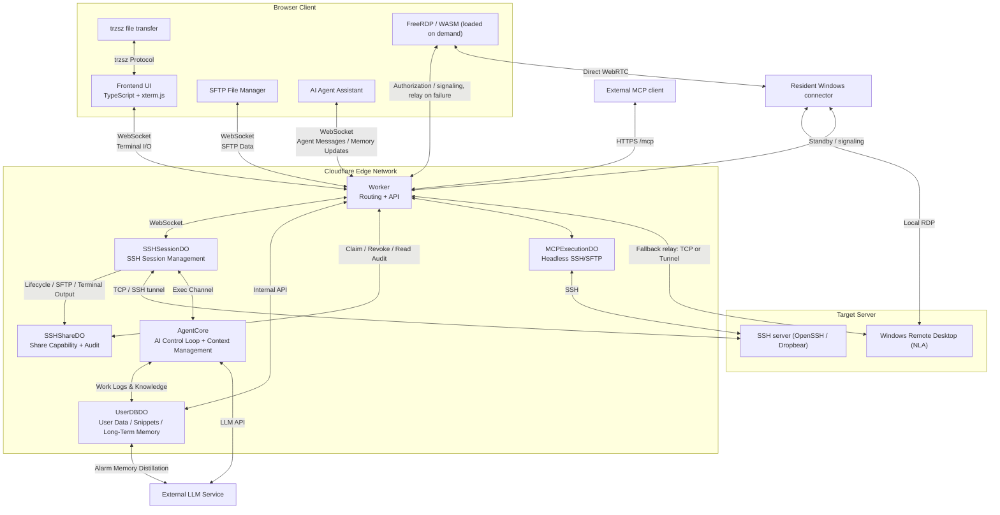

<div align="center">
  
  <p>A browser-based SSH terminal and SFTP client on Cloudflare Workers. Signed-in users can also manage saved servers and, when enabled, open Windows Remote Desktop in the same tab.</p>
  <p><b>Ultra-lightweight · Out-of-the-box · Cyberpunk UI</b></p>
  <p>
    <a href="https://github.com/newbietan/CloudSSH/stargazers"></a>
    <a href="https://afdian.com/a/newbietan" target="_blank"></a>
    <a href="LICENSE"></a>
    
    
    
  </p>
  <p>
    <a href="#highlights">Highlights</a> ·
    <a href="#features">Features</a> ·
    <a href="#quick-start">Deployment</a> ·
    <a href="#architecture">Architecture</a> ·
    <a href="CHANGELOG.md">Changelog</a> ·
    <a href="#contributors">Contributors</a> ·
    <a href="#sponsor">Sponsor</a> ·
    <a href="#special-thanks">Special Thanks</a> ·
    <a href="#license">License</a>
  </p>
  <p>
    <a href="README.md">简体中文</a> |
    <a href="README_en.md">English</a>
  </p>
</div>

> [!TIP]
> **CloudSSH** utilizes Cloudflare Workers' TCP Sockets support to handle SSH protocol parsing and forwarding at edge nodes, providing a low-latency Web Terminal experience.

## Demo

> Imagine opening your browser anytime, anywhere, and connecting to your server with a highly futuristic cyberpunk UI, without installing any SSH client.

<div align="center">
  <a href="https://www.bilibili.com/video/BV1UgMt6UEdF" target="_blank" title="Click to play video">
    
    <br/>
    
  </a>
  <p><sub>Video duration 19:48 · Full CloudSSH walkthrough</sub></p>
</div>

## Table of Contents

<details>
<summary><b>Click to expand Table of Contents</b></summary>

- [Highlights](#highlights)
- [Features](#features)
- [Architecture](#architecture)
- [Quick Deployment](#quick-start)
  - [GitHub Integration](#recommended-deploy-via-github-integration)
    - [Automatically Sync Upstream](#sync-upstream)
  - [Configurable Environment Variables](#configurable-environment-variables)
  - [Enable Cloudflare Access Login](#optional-enable-cloudflare-zero-trust-access-login)
  - [Enable Single-Admin Password Login](#optional-enable-single-admin-password-sign-in-alternative-to-github-oauth)
  - [Configure Turnstile](#optional-configure-turnstile-human-verification)
  - [Configure GitHub OAuth](#optional-configure-github-oauth-login--server-management)
  - [Windows Remote Desktop](#windows-rdp)
- [Development](#development)
  - [Local Development](#local-development)
- [Contributors](#contributors)
- [Sponsor](#sponsor)
- [Special Thanks](#special-thanks)
- [License](#license)

</details>

<a id="highlights"></a>

## Highlights

### Ultimate Serverless

- **No gateway to maintain**: A Worker and SQLite-backed Durable Objects run the service. Cloudflare usage limits and charges depend on your plan.
- **Edge Acceleration**: Cloudflare's global edge network routes connections to the nearest location for low-latency SSH.

### Out of the Box

- **One-Click Deployment**: Fork the repo and connect GitHub in the Cloudflare Dashboard to build and deploy automatically, no local environment needed.
- **Modern Tech Stack**: TypeScript + Vite + Tailwind CSS + xterm.js, balancing performance and maintainability.

### Secure and Reliable

- **Two-Segment Encryption**: HTTPS/WSS between browser and Worker; the Worker-to-server segment uses the full SSH-2.0 protocol (Curve25519-SHA256/ECDH-NISTP256 key exchange, AES-256-GCM/CTR encryption, HMAC-SHA2 integrity).
- **Host-Key Verification**: Ed25519/ECDSA P-256/P-384/P-521/RSA signature checks with a SHA-256 fingerprint on first connection (TOFU). Ed25519, RSA-SHA2-256/512, and ECDSA P-256/P-384/P-521 OpenSSH host certificates are supported: certificate signatures, lifetimes, host type, and critical restrictions are checked, then the underlying public key verifies the SSH handshake and supplies a stable fingerprint. This remains public-key TOFU: the embedded CA is not automatically trusted, principals are not treated as CA-authorized host identities, and no trusted-CA store is provided. Renewing a certificate keeps the same public-key fingerprint; actual key changes still require explicit confirmation.
- **Encrypted Keys and MFA**: Both the connection form and saved-server editor accept pasted keys or local key files (up to 128 KiB, including extensionless files). Browser-local unlocking supports OpenSSH bcrypt/AES-CTR and PKCS#8 PBES2 keys. Passphrases are neither saved nor sent to the Worker; unlocked keys still reach the Worker for SSH signing. Anonymous imports are transient by default, and saving an unlocked key requires separate consent. Public-key authentication may be followed by an explicitly entered password factor; existing OTP challenges remain supported. See [SSH compatibility and interoperability notes](docs/ssh-compatibility.md) for limits and real-server tests.
- **Defense in Depth**: IPv6/reserved-address SSRF blocking plus DNS-rebinding protection, bounded in-memory rate limiting, Turnstile verification, and AES-256-GCM encryption for saved credentials in per-user SQLite storage.
- **Session Isolation**: Each terminal session runs in an independent Durable Object; an active outbound SSH TCP connection keeps it awake.
- **Saved credentials**: For SSH, a one-time ticket opens the session without returning the saved password or key to the browser. Windows Remote Desktop is different: on an explicit connection, the signed-in browser receives the saved login for its FreeRDP client; the device list never includes the password.

<a id="features"></a>

## Features

<details>
<summary><b>Click to expand full feature list (Custom SSH Stack, Jump Chains, One-Time Sharing, SFTP, AI Agent, etc.)</b></summary>

- **Pure TypeScript SSH-2.0 Implementation**: Fully self-developed SSH protocol stack, with no dependency on any third-party SSH libraries, implementing all cryptographic operations based on Web Crypto API.
- **Multi-Algorithm Key Exchange**: Supports Curve25519-SHA256 (preferred) and ECDH-NISTP256 KEX algorithms, compatible with various SSH servers (including Dropbear).
- **Reliable Key Transitions and Packet Framing**: Re-evaluates encryption and authentication state for every packet, including servers that return `SSH_MSG_NEWKEYS` and the first encrypted packet in the same TCP chunk.
- **IPv4/IPv6 Dual Stack**: Full support for both IPv4 and IPv6 address connections, including automatic handling of IPv6 bracket notation.
- **Multiple Auth Methods**: Supports standard SSH password authentication, RFC 4252 §5.2 `none` authentication, multi-round RFC 4256 `keyboard-interactive` authentication, and OpenSSH-format Ed25519, ECDSA P-256/P-384/P-521, and RSA private keys. Select **None** to send only a username, without a password or private key. The server must explicitly accept this method; rejection does not fall back to other methods. This is not empty-password login. A username may grant access: keep it secret and note that local connection history stores usernames. Password mode accepts an empty password. When editing a saved password, leaving the field blank keeps the original; select **Set an empty password** to clear it. Interactive authentication supports pressing Enter to submit an empty response, zero-prompt rounds, passwords, OTPs, multiple prompts, and a second factor after public-key authentication. Server prompts appear in a connection-bound safety dialog, and a saved password is substituted only after an explicit user action. RSA uses RSA-SHA2-256/512 by default; legacy `ssh-rsa` SHA-1 is allowed only through explicit compatibility configuration.
- **SSH Jump Hosts / Bastions**: Signed-in users may select another saved server as a jump host. CloudSSH builds each layer with the standard RFC 4254 `direct-tcpip` channel and does not require `ssh`, `nc`, or `socat` on the remote host. Up to 3 jump hosts are supported; the final target's terminal, SFTP, and AI Agent use the complete encrypted chain. Authentication and path-scoped host-key verification run independently at every hop.
- **Cloudflare Tunnel (Zero Trust Tunnel)**: Connect directly to intranet servers without public IPs or open ports (homelabs, private LANs) using Cloudflare Tunnel (cloudflared), eliminating the need for a jump host. Leverages the standard WebSocket Carrier architecture to transparently stream SSH binary frames, supporting optional Cloudflare Zero Trust Service Tokens (Client ID / Client Secret). The proprietary SSH stack, TOFU host keys, SFTP, and AI Agent operate seamlessly over the tunnel.
- **One-time SSH sharing**: Signed-in owners can issue a single-use link for a saved SSH server. The link contains no login credentials. Recipients get a terminal and SFTP, not Agent or MCP access. Owners can revoke a share and review its audit (lifecycle, SFTP operations and terminal output).
- **MitM Protection (TOFU)**: Automatically extracts and prints the server's Host Key (SHA-256 fingerprint) on the first connection, supporting Ed25519/ECDSA/RSA signature verification, and caches known host keys locally and via API to prevent MitM on future connections.
- **Terminal rendering**: xterm.js uses WebGL when available. Excessive unacknowledged output closes the session rather than buffering indefinitely.
- **Copy from Herdr and other remote apps (OSC 52)**: Copy normally in the active terminal, without an extra permission step. If the browser blocks automatic writing, click **Copy to clipboard**, or press `Alt+Shift+C` followed by Enter. Background output cannot write to the clipboard, and shared sessions are excluded.
- **Reliable Terminal Clipboard Interaction**: Completing a terminal selection with a mouse automatically copies it, and right-click pastes directly. On touch devices, Select enters a dedicated mode with adjustable endpoint handles, edge scrolling through history, and explicit Copy/Cancel actions; native long-press menus are suppressed only in selection mode. Paste remains separate and offers an ephemeral, session-bound manual dialog when clipboard reads fail (up to 65,536 characters; multiline text may execute commands). Paste data follows xterm.js's native input pipeline, emits bracketed-paste control sequences only when the remote application enables that mode, and normalizes line endings for compatibility with Vim and regular shells.
- **Precise Touch Controls**: More offers 12–18px terminal font sizing/Auto (remembered on this device) and current-tab actions. SFTP adds explicit Open, checkbox multi-select, Select all and Clear selection while retaining existing editing, sequential downloads and batch deletion. Leaving an active transfer by closing a drawer, switching tabs/drawers or returning to the connection page asks before interrupting it; disconnection and teardown still clean up immediately, without background transfers. See [mobile interaction notes](docs/mobile-ux.md) for behavior and device-testing limitations.
- **Mobile SSH**: The terminal adapts to the on-screen keyboard and safe areas. Use the shortcut bar for modifiers, arrows and Esc. Returning from the background checks the WebSocket; brief interruptions may resume the existing shell. If a new saved-server connection is needed, it requires a fresh ticket. Input stays disabled until the shell is ready.
- **Customizable UI & Liquid Segmented Controls**: Theme V4 offers built-in Standard Dark, Standard Light, Cyberpunk, and macOS 26-inspired Liquid Glass themes. The user space header and terminal action bar feature floating glass dynamic islands and liquid segmented controls, integrating SFTP, custom commands, and AI Agent drawers into a unified pill capsule driven by a shared 1D physics spring engine (`spring.ts`, using Euler numerical integration) with a smooth 3D liquid lens slider for seamless mutually exclusive drawer toggling. Pointer specular spotlights are generalized across all themes (rAF-throttled CSS variable transmission, automatically bypassed on touch devices for power savings), accompanied by staggered card and row entrance animations, cold-loading skeleton screens (with complete ARIA accessibility attributes), global unified `:focus-visible` theme rings, and W3C multi-layer box-shadow syntax compatibility fixes. V4 adds gradient/mesh background layers (with a readability scrim and a slow drift animation), a scanline/flicker/glow/noise effect registry, an independent surface-blur and saturation tier (`saturate(180%)` + specular inner highlights), and typography scaling, with full support for `prefers-reduced-motion` and `data-ui-motion` tiers. Background drift uses an independent clipped layer and prepainted textures animated with `transform`, reducing main-thread paint without reducing glass materials, blur, or glow. The companion [GitHub Pages theme editor](https://newbietan.github.io/CloudSSH/theme-editor/) provides live controls for colors, shape, density, font, shadows, motion, background layers, effects, and button/input/card/tab styles, with previews for login, server list, terminal + SFTP, and the AI Agent panel. The theme segmented bar persistently displays 5 options (4 built-in + 1 Custom), with the standalone upload button removed. Clicking Custom when no theme has been uploaded opens a management modal prompting upload; clicking Custom while already active opens the modal to manage multiple themes (color swatches preview, instant switching, deletion confirmation, up to 20 custom themes). Signed-in users sync their theme library to the cloud for cross-browser restoration, while anonymous users keep them in the current browser only.
- **Local Fonts and Icons**: Material Symbols Outlined and JetBrains Mono ship with the project. Fonts are inlined into the main app's single HTML and served from the same origin by the theme editor, removing the Google Fonts dependency; normal builds do not download fonts. This is not a fully offline app: authentication, SSH, and other network features remain unchanged. See the [font sources, licenses, and maintenance guide](docs/local-fonts.md).
- **Responsive Server Forms**: Add, edit, and duplicate dialogs use two columns on wide screens, with name/tags side by side and connection/authentication settings grouped separately. Narrow screens, short windows, and larger typography retain field-area scrolling while the title and save action stay reachable. All built-in and custom themes share the layout. Both saved-server forms and anonymous connections display all five port digits while preserving native number controls and validation.
- **SFTP Graphical File Manager**: Integrated with a complete SFTP v3 file transfer protocol, providing a graphical file browser interface. Parent-level event delegation and incremental selection updates reduce redundant listeners and DOM writes in large directories while retaining the complete list and existing selection behavior. The toolbar features hierarchical path breadcrumbs navigation (click to jump directly to parent directories, click empty space to toggle absolute path text input), and file lists support bidirectional sorting by name, size, and modified time (directories stay pinned to the top). Supports one-click creation of new blank files with automatic CodeMirror editor opening. Supports directory browsing, file upload/download, creating new folders, file renaming, and deletion, plus plain selection, `Cmd/Ctrl` toggle selection, `Shift` range selection, select all, batch file downloads, and batch deletion. Double-clicking files is handled intelligently (text files open directly in the online editor, binary or oversized files automatically route to the serial download queue). Built-in CodeMirror online editor edits remote text files in place (≤2MB; UTF-8 editable, GBK/GB18030 detected as read-only), preserving the original line endings and BOM, with automatic remote-change detection and an explicit overwrite confirmation before saving, as well as line-wrapping preference toggling in the footer. Common configs (shell/YAML/JSON/Python/Markdown/HTML/CSS/Dockerfile/systemd, etc.) get syntax highlighting. Built on the SSH subsystem, it runs alongside terminal sessions without interference and supports download queues and upload cancellation.
- **Native File Transfer**: Integrated with [trzsz.js](https://github.com/trzsz/trzsz.js), supporting `trz` (upload) / `tsz` (download) commands for file transfer, fully compatible with tmux sessions. Also supports drag-and-drop file upload to the terminal, directory transfer, and resumable transfers. (Requires [trzsz](https://trzsz.github.io/) installed on the remote server)
- **Multilingual UI**: Ships built-in Simplified Chinese, Traditional Chinese, and English translations, automatically following the browser language with a manual override; the choice is persisted via a URL parameter or local storage (`cloudssh_locale`).
- **Saved servers**: GitHub, administrator password and Access accounts each have a private server list. SSH and Windows cards share tag filters, host/username/name search, sorting and pagination (six cards on desktop/tablet, three on mobile). Duplicating an SSH configuration copies its settings, not its credentials.
- **Slide-Over Command Snippet Drawer & Category Management**: Completely redesigned into a slide-over drawer panel matching the SFTP layout, keeping the active terminal fully visible side-by-side. Features horizontal **Category Chips** for deduplicated count aggregation and filtering, `<datalist>` category autocompletion on the collapsible entry form, and real-time fuzzy search. Supports `{{var}}` dynamic parameter placeholders with parameter entry dialogs, one-click plain text copying, and filling into or executing directly on the active terminal. Snippets are stored with per-`user_id` row isolation in `UserDBDO` (name ≤50, command ≤2000, category ≤30, ≤100 per user); anonymous users fall back to local `localStorage`. Reachable from desktop and mobile toolbars, and hidden in one-time share sessions.
- **Automatic Server OS Detection**: When a signed-in user first connects to a saved server without an OS record, CloudSSH uses a separate SSH exec channel after the terminal is ready to read `/etc/os-release` or `uname`, then shows the corresponding system icon on the server card. Detection runs in the background without blocking the terminal. Only recognized results are saved; unknown results are retried naturally on the next connection, and changing the host or port clears stale results. Anonymous connections do not run this check. The read-only command may appear in the target server's SSH audit logs.
- **Private IP Display and Quick Copy**: Valid IPv4 and IPv6 addresses are visually masked in the saved-server list and connection status bar to reduce accidental disclosure in demos or screenshots. The complete connection address remains available through mouse or keyboard copy. Hostnames remain unchanged; visual masking is not encryption or access control.
- **Single-Page Multi-Tab Session**: Switch between multiple independent SSH terminal and SFTP instances within a single browser tab, with isolated sandbox environments. Tabs support double-click inline renaming (Enter to save, Esc or empty input to cancel and restore original name, synchronized immediately to the header), plus a right-click context menu (rename tab, duplicate session to new tab, close other tabs, close tab). While on the server list or anonymous connection page, a toolbar/form button returns you to an established SSH session in one click, and pressing `Esc` does the same when the terminal is hidden; the button appears and hides along with the tab count.
- **Secure Connection History**: Saves last 5 connection records locally. Credentials (passwords/private keys) can be client-side encrypted using locally derived AES-256-GCM keys.
- **SSH latency**: The status bar separates browser–Worker WebSocket RTT from the Worker’s SSH-side latency estimate. The Cloudflare colo code identifies the serving location, not another latency measurement.
- **Smart Region Scheduling (locationHint)**: Queries IPinfo when a direct server is saved, persists the inferred Durable Object region, and reuses it on connection without another runtime geo lookup. With SSH jumps, only the outermost entry reached directly by Cloudflare is inferred; downstream private servers do not trigger a lookup and inherit placement from that entry. Failures fall back to Cloudflare's default placement, and users may manually override direct-entry regions. _Note: automatic inference sends the direct entry's host information to the third-party IPinfo service. locationHint is a Cloudflare best-effort feature and may fall back to a nearby region when capacity is unavailable._
- **In-Terminal Text Search & Shortcuts**: Real-time log search support via `Ctrl+Shift+F` (or `Cmd+F` on macOS); clear terminal screen and scrollback buffer via `Cmd+K` (macOS) / `Ctrl+Shift+K` (Win/Linux) without conflicting with shell-native `Ctrl+K`.
- **Terminal Log Export**: Download the entire screen buffer of the active terminal session as a `.txt` file with a single click on the header download button, avoiding browser freezes when selecting long logs.
- **AI Operations Assistant & Server Memory**: Use your own key with standard stateless Responses APIs (`store:false`) to deploy, configure, and troubleshoot your servers. Includes streaming replies, quick diagnostic prompts, terminal-selection attachments, code copying, and command filling. Ten tools cover command execution, terminal context, environment checks, processes, systemd, Docker, public web reads, remote file reads and writes, and user confirmation. Dangerous commands still require confirmation.
  - **Reuse Existing Information Directly**: Saved configuration, knowledge, and complete credentials are provided to the Agent without provenance checks, automatic expiry, keyword retrieval, or additional redaction. Previously supplied keys need not be entered again. Values support up to 16,384 characters; credentials preserve spaces, newlines, and empty passwords using the existing encrypted storage. UI masking affects display only, with reveal, copy, edit, and delete controls.
  - **Readable Work Logs & Simple Background Retries**: The LLM summarizes normal conversation into readable work history and reusable knowledge; related work can merge within 30 minutes. Conversation is persisted in SQLite and processed by UserDBDO Alarms, including after disconnection or instance restart. Failed extraction receives up to three additional retries, then the task is removed on success or exhaustion. No separate evidence package, execution ledger, dual queue, receipt framework, or notification polling. See [context and memory](docs/agent-context-memory.md).
  - **Long-Task Context Summaries**: Older conversation is summarized through standard `/responses` calls while recent complete tool exchanges are retained. No `/responses/compact` dependency. Context and output budgets follow provider metadata or a known model profile; unknown models default to 128,000/8,192 tokens. There is no manual budget field.
  - **Compatibility & Diagnostics**: Model capabilities vary; bounded compatibility changes apply only to explicitly unsupported optional parameters, and incomplete tool calls are not executed. Errors stay concise; detailed diagnostics appear in the web terminal only with `DEBUG_MODE=true`. Model configuration retains its custom dropdown, same-address discovery using saved credentials, and Base URL binding. Requests use `store:false`; verify the provider's actual retention policy.
- **Official CI**: `test` runs type checks, unit/integration tests, a frontend build, and Chromium/mobile WebKit by default. A successful push deploys to the test environment. `main` deploys only the exact file tree of a successful full `test` push, without rerunning tests. PRs and manual runs never deploy, and reduced browser profiles on `test` cannot approve a production release. [Workflow](.github/workflows/deploy.yml).

### External AI assistants (MCP)

After signing in, open the connection-node **External AI assistant MCP settings** icon to generate one permanent account configuration with independently editable permissions per server, repeatable copying and no revocation control. Compatible clients such as Claude Code and Cursor can use `https://your-instance/mcp` for independent commands and bounded SFTP text operations. Explicitly share recent output from a terminal tab and expand recent operation records in the panel; idle connections are released automatically.

Exec is advance authorization, not a read-only sandbox or per-command browser approval. The endpoint neither takes over your interactive terminal nor exports stored SSH credentials. Verify every hop's host key first; interactive authentication and browser-issued CA credentials are unsupported. Cloudflare Access sign-in shows a dedicated Service Token / Service Auth guide; the entered credentials are included alongside the personal token in the client configuration, stored with the personal token using recoverable account encryption. The key remains in the same database, not an independent KMS. Legacy digest-only tokens require one new configuration. Other sign-in modes do not show this setup. See [MCP setup, limits and DO migration](docs/mcp.md).

</details>

<a id="architecture"></a>

## Architecture

### System Architecture



<a id="quick-start"></a>

## Quick Deployment

### Prerequisites

- A Cloudflare account.
- A Workers deployment that supports outbound TCP sockets and SQLite-backed Durable Objects. The Free and Paid plans have different [Workers limits](https://developers.cloudflare.com/workers/platform/limits/) and [Durable Objects pricing](https://developers.cloudflare.com/durable-objects/platform/pricing/).

### Steps

#### Recommended: Deploy via GitHub Integration

<div align="center">
  <a href="https://dash.cloudflare.com/?url=https://github.com/newbietan/CloudSSH">
    
  </a>
  <p>Click the button to jump to the Cloudflare console, authorize your GitHub account, and deploy automatically</p>
</div>

1. **Fork this repository** to your GitHub account.
2. **Create Worker App**: Log in to Cloudflare, go to Workers & Pages, click Create Application, connect your GitHub account, and select the forked repository.
3. **Build Command**: During deployment settings, enter `pnpm run build:frontend` as the Build command, then save and deploy.
4. **Access the App**: After successful deployment, access via the default domain `https://cloudssh.<your-subdomain>.workers.dev`.
5. **Bind Custom Domain** (Optional): Go to Worker Settings → Domains & Routes → Add, enter your domain and confirm.

To skip automatic Cloudflare Git builds based on changed file paths, configure include/exclude rules under the Worker’s **Settings → Build → Build watch paths**; see the [official guide](https://developers.cloudflare.com/workers/ci-cd/builds/build-watch-paths/). These settings are independent of GitHub Actions `paths-ignore`.

##### Update Notices

The project checks the official `main` branch for a newer stable version in the background; when a new version is available, a dismissible hint is displayed. Click to view the changelog; upgrading is entirely at the deployer's discretion by syncing the repository and redeploying. Nothing is automatically refreshed, upgraded, or disconnected. Dismissing a version does not hide later releases.

<a id="sync-upstream"></a>

##### Optional: Automatically Sync Upstream Releases (Auto Update)

A fork can optionally use the built-in `Sync upstream` GitHub Actions workflow to synchronize this project's latest `main` branch into its own `main` branch. **Manual sync requires no repository variable; scheduled sync is disabled by default.** Once explicitly enabled, scheduled sync checks daily at 04:20 Asia/Shanghai. Branch updates created by a successful sync are automatically built and deployed by Cloudflare Git integration, without additional CI deployment credentials.

1. Make sure the Cloudflare Worker is connected to your fork, its Production branch is set to `main`, and automatic builds are enabled.
2. Open the fork's **Actions** page and enable workflows. If an existing fork does not yet contain `Sync upstream`, first use GitHub's **Sync fork** feature once to obtain the workflow.
3. **On-demand sync**: Open **Actions → Sync upstream → Run workflow**, select `main`, and run it manually. No repository variable is required.
4. **Optional scheduled sync**: Go to **Settings → Secrets and variables → Actions → Variables** and create a Repository variable:
   - Name: `AUTO_SYNC_UPSTREAM`
   - Value: `true`
   - Delete the variable or set it to `false` to disable scheduled sync. Manual runs remain available.

> **Sync behavior**: If upstream workflows change, automatic synchronization may fail. In that case, simply synchronize the repository manually once.

#### Configurable Environment Variables

Configure only the Worker settings your deployment needs. SSH sharing is built in, and SSH host-key signature verification cannot be disabled.

<details>
<summary><b>Worker environment variables</b></summary>

Defaults are from [wrangler.toml](wrangler.toml). A pair means **production / test**; a dash means unset.

| Variable | Default | When to set it |
| --- | --- | --- |
| `IDLE_TIMEOUT` | `30m` | Disconnect idle sessions; accepts `30m`, `1h` or seconds. `0` disables the inactivity timeout. Passive terminal output is not user activity. |
| `REQUIRE_AUTH` | `false` / `true` | Require sign-in for ordinary SSH; an administrator password session also qualifies. One-time shares still require their own authorization. |
| `GITHUB_CLIENT_ID` | — | Public GitHub OAuth client ID. Configure with the secret below; not needed for other login modes. |
| `GITHUB_CLIENT_SECRET` | — | GitHub OAuth client secret. Store as a **Secret**. |
| `BASE_URL` | Request origin | Optional canonical site URL for GitHub OAuth, e.g. `https://ssh.example.com`. Register `/api/auth/callback` on that origin in GitHub. |
| `GITHUB_ALLOWED_USER_IDS` | — | Comma-separated numeric GitHub IDs. Unset means unrestricted; an empty or invalid configured list denies GitHub sign-in. |
| `ADMIN_PASSWORD_HASH` | — | Single-admin password verifier (**Secret**), generated at `#password-setup` or by `pnpm run hash-password`. Takes precedence over Access and GitHub. |
| `CF_ACCESS` | Runtime detection | Set to `true` to force Access mode. Browser login is denied without native identity; this does not install an edge Access policy. |
| `TURNSTILE_SITEKEY` | — | Public browser widget site key. Configure both Turnstile keys together. |
| `TURNSTILE_SECRET` | — | Server-side verification **Secret**. Setting only the secret requires verification without a usable browser widget. |
| `DEBUG_MODE` | `false` / `true` | Enable additional diagnostics for troubleshooting. Leave off in normal production use. |

For Git/CLI deployments, configure ordinary values in the target environment’s Wrangler `vars` table. Deployments can replace ordinary Dashboard variables. Store credentials under **Settings → Variables and Secrets → Secret**. Durable Object bindings and migrations are already defined in Wrangler; they are not additional environment variables.

**Upgrading an existing deployment?** `REQUIRE_GITHUB_AUTH` has been renamed to `REQUIRE_AUTH`. The old name is no longer read. If your production instance requires sign-in, set `REQUIRE_AUTH = "true"` in its `[vars]` before upgrading; otherwise ordinary SSH will allow anonymous connections by default.

`ENABLE_RDP` has been removed. Even if it was `false`, signed-in users can now use [Windows Remote Desktop](#windows-rdp) over HTTPS. You can also remove `MAX_CONNECTIONS` (previously unused), `ENABLE_SSH_SHARING`, `STRICT_HOST_KEY_VERIFY` and `CF_ACCESS_TEAM_NAME`. Old `false` values no longer disable sharing or bypass signature checks. No server is shared automatically. Enter the SSH CA team name in the form; existing saved team names are unchanged.

</details>

#### Optional: Enable Cloudflare Zero Trust Access Login

Sign in through Cloudflare Access using Cloudflare account authorization, email One-Time PIN, or your team's identity provider, without a separate GitHub OAuth setup or fixed password:

1. Configure a policy in the Worker's **Access** panel, or create a **Self-hosted** application in **Zero Trust → Access → Applications**. Ensure the effective policy covers the CloudSSH page, `/api/*`, and WebSocket paths, not just a login page.
2. Allow trusted emails or controlled team domains. Protect every reachable entry point, including `workers.dev`, or disable unused entry points.
3. Open the site and authenticate. CloudSSH obtains verified identity from the Workers runtime's `ctx.access.getIdentity()` and isolates databases by email. Client-provided email headers and unverified JWTs are not identity evidence. No additional AUD or verification key configuration is needed; Sign Out redirects to `/cdn-cgi/access/logout`.

> **Configuration and connection checks**: If Access configured through the Worker panel already supports login and SSH connections, no migration is needed. The configuration entry point does not identify the effective policy type: [Cloudflare's documentation](https://developers.cloudflare.com/workers/configuration/cloudflare-access/) separately describes WebSocket restrictions for Worker-level policies, and hostname/path policies may take precedence. If the page loads but SSH returns 403, check the effective policy, WebSocket hostname/path, Origin, and login session instead of attributing the failure solely to the panel used. `CF_ACCESS=true` requires a verified Access identity but does not configure an edge policy; login is rejected without that runtime identity.

> **Auth Mode Priority**: `ADMIN_PASSWORD_HASH` (password first) > `CF_ACCESS` / auto-detected (Access mode) > `GitHub OAuth` > Anonymous mode. When multiple configurations coexist, the higher priority mode is authoritative.

#### Optional: Enable Single-Admin Password Sign-In (Alternative to GitHub OAuth)

Prefer signing in with your own custom password instead of GitHub OAuth? The instance then admits a single account — yours:

1. **Generate the hash**: Enter your custom password (≥ 10 characters), confirm it, click "Generate hash", and copy the result. **The password never leaves your browser** — no local tooling required. Ways to open the generator:
   - Fresh deployment (no sign-in configured): open your site and click "**Admin password sign-in setup**" at the bottom of the auth form;
   - Instances already using GitHub sign-in (including `REQUIRE_AUTH=true` forced login): open `https://your-domain/#password-setup` directly — no existing variables need touching;
   - Password rotation: open `#password-setup`, regenerate, and replace the Dashboard variable.
2. **Configure the variable**: In the Cloudflare Dashboard → Workers → Settings → Variables and Secrets, add `ADMIN_PASSWORD_HASH` (**Secret** type), paste the generated hash, and save.
3. **Reload** and sign in using **Admin Login**. The administrator has a separate account and saved servers.

> **Rotation**: Generate a new hash and replace the old value directly. This invalidates existing password sessions. Removing the variable instead selects the next available mode (Access, GitHub, or anonymous); it does not merge account data.

> **Note**: For local CLI deployment or debugging the Worker, see the Local Development section under Development below.

#### Optional: Configure Turnstile Human Verification

To prevent malicious bot abuse, it is recommended to enable Cloudflare Turnstile verification:

1. **Create Turnstile Widget**: Log in to [Cloudflare Dashboard](https://dash.cloudflare.com/), go to the Turnstile page and create a new Widget.
2. **Get Keys**: After creation, you will receive a **Site Key** (public) and a **Secret Key** (private).
3. **Configure Environment Variables**: In the Cloudflare Dashboard Workers settings, go to "Settings" → "Variables and Secrets", add the following environment variables:
   - `TURNSTILE_SECRET` = your Secret Key
   - `TURNSTILE_SITEKEY` = your Site Key
4. **Redeploy**: Run the deployment command to apply the configuration.

#### Optional: Configure GitHub OAuth Login & Server Management

GitHub OAuth is one way to sign in and manage saved servers. If you already use administrator password or Cloudflare Access sign-in, you do not need GitHub OAuth.

1. **Create a GitHub OAuth App**:
   - Go to GitHub → Settings → Developer settings → OAuth Apps → [New OAuth App](https://github.com/settings/applications/new)
   - **Application name**: `CloudSSH` (customizable)
   - **Homepage URL**: `https://your-domain.com` (your deployed domain)
   - **Authorization callback URL**: `https://your-domain.com/api/auth/callback`
   - After creation, note the **Client ID**, then click **Generate a new client secret** to get the **Client Secret** (shown only once, save it immediately)

2. **Configure Environment Variables**: In the Cloudflare Dashboard Workers settings, go to "Settings" → "Variables and Secrets", add the following environment variables:
   - `GITHUB_CLIENT_ID` = your Client ID
   - Optional: `BASE_URL` = `https://your-domain.com` if a fixed callback origin is needed.
   - `GITHUB_CLIENT_SECRET` = your Client Secret

   The following two independent settings are optional:

   - `GITHUB_ALLOWED_USER_IDS`: Comma-separated GitHub **numeric user IDs** allowed to sign in, for example `83105156,6236783`. When omitted, every GitHub account may sign in. An empty or malformed configured value fails closed and denies every GitHub sign-in.
   - `REQUIRE_AUTH`: Set to `true` to require login for ordinary SSH. A valid one-time share is a separate authorization path.

   **Find a GitHub numeric user ID**:

   - Open `https://api.github.com/users/octocat` in a browser (replace `octocat` with the actual username) and read the `id` field in the returned JSON. For example, `"id": 583231` means the numeric user ID is `583231`.
   - Or run:

     ```bash
     curl -s https://api.github.com/users/octocat | jq '.id'
     ```

   Use `id`, not the username or `node_id`. The numeric ID does not change when the username changes; separate multiple IDs with commas.

| Configuration                   | GitHub sign-in         | Anonymous SSH                    |
| ---------------                 | ----------------       | ---------------                  |
| Neither setting                 | All GitHub users       | Allowed                          |
| `GITHUB_ALLOWED_USER_IDS` only  | Allowlisted users only | Allowed                          |
| `REQUIRE_AUTH=true` only | All GitHub users       | Disabled                         |
| Both settings                   | Allowlisted users only | Disabled (private-instance mode) |

##### Using One-Time SSH Sharing

1. Sign in to CloudSSH and save the SSH server under your account. No deployment switch is required.
2. Connect normally to the target and every jump host first so all route-scoped host fingerprints are trusted.
3. Select **Share** on the server card. Choose the claim window (5/15/30/60 minutes), maximum session duration (15/30/60/120 minutes) and audit retention (7/30/90/180/365 days; default 90).
4. Copy the generated link immediately and send it through a trusted channel. CloudSSH does not retain the plaintext capability, so the same link cannot be displayed again.
5. The recipient accepts the audit notice and claims the link once. A device bound at claim time can resume the same live session after a brief network drop (about 60 seconds). This is not a new login: the link cannot be claimed again, and expiry or revocation ends access.
6. The owner can reopen Share management to inspect status and audit records or revoke a pending/live share. Revoking a live share closes both terminal and SFTP.

> [!WARNING]
> Although the capability contains no SSH metadata, possession grants a full Shell and SFTP session using the owner's saved credential, so protect it like a temporary password. Sharing requires trusted fingerprints for the complete route and stops on fingerprint changes or `keyboard-interactive`/MFA challenges. Audit stores server PTY output rather than raw keyboard input: it usually shows shell-echoed commands but cannot prove every command executed with echo disabled, inside scripts, or through encoded input. Do not treat it as host-level enhanced auditing. A session is closed on reaching its audit budget (5 MiB or 5,000 events), or if an audit write fails.

##### Using SSH Jump Hosts

SSH jump hosts require a signed-in account and saved servers, not a particular sign-in provider or an environment switch:

1. Save the outermost public jump host A, which Cloudflare can reach directly.
2. Save target B and select A in the **Jump host** field. B may use a private address that is reachable only from A.
3. For a multi-hop path such as C → A → B, configure C as A's jump host, then configure A as B's jump host. CloudSSH resolves the relation recursively and permits at most 3 jump hosts.
4. Connect to B from the server list. Terminal, SFTP, and AI Agent channels open only on final target B; a failure at any hop closes or rebuilds the complete chain.

Every server in a jump relation must belong to the same CloudSSH account. Self-references and cycles are rejected, and a jump host cannot be deleted while another server references it. Public-address SSRF checks and Durable Object region placement use the outermost address reached directly by Cloudflare. Only that entry runs automatic region inference; selecting a jump host disables the downstream server's region option and does not send its private host information to IPinfo. Private targets are accepted only inside a server-resolved saved chain, and anonymous clients cannot submit jump configuration. TOFU host-key verification runs at every hop, with private target records scoped by the complete jump path.

<a id="windows-rdp"></a>

##### Windows Remote Desktop

RDP is built in for both production and test. It requires HTTPS and a signed-in account; anonymous users and one-time share recipients have no RDP access. It does not provide SFTP, Agent, MCP, jump hosts or one-time shares.

1. Choose **Add Server → Windows Server**. The **Connector** route needs no public IP or inbound port and has no relay fallback. To configure a fallback, enter a public IPv4/IPv6 address or hostname (including DDNS) and TCP port (default `3389`), or enter a published Cloudflare Tunnel hostname. Keep RDP and NLA enabled on Windows.
2. Enter the Windows username (default `Administrator`), password and optional domain. The login is encrypted in your account. Older devices without credentials must be completed before connecting.
3. Connect from the card. On first use, verify the Windows certificate’s SHA-256 fingerprint before accepting; a changed pin blocks login. The desktop opens in the same tab. **Back** disconnects without signing out of Windows; **Full screen** scales the entire image below the toolbar without renegotiating resolution.

Choose **Download and link this device** on the setup page. Extract the [device-specific ZIP](docs/rdp-peer.md) on the target Windows PC and run the installer. The service links automatically. No binding code, extra confirmation, or Worker secret is required. All three routes can use WebRTC. Open Desktop prefers it and silently uses the configured public TCP or Tunnel relay if direct setup fails before sign-in. The toolbar prefers the selected **WebRTC** link RTT (or explicitly labels the **Channel** sample when unavailable) and labels relayed sessions **Relay**. Open the latency details for the channel peak, browser read backlog, and Windows-reported RDP RTT. See [RDP setup and limits](docs/rdp.md).

##### Connecting via Cloudflare Tunnel

When adding or editing a server, choose the **Cloudflare Tunnel** transport mode to directly connect to private intranet servers (homelab NAS, private LAN hosts, internal dev machines) without public IPs or port forwarding:

1. **Configure cloudflared on the internal server**: Run Cloudflare Tunnel on your internal machine and map a public hostname to your local SSH service (e.g., `service: ssh://localhost:22`).
2. **Add the server in CloudSSH**:
   - **Network Connection**: Switch to the "Cloudflare Tunnel" tab;
   - **Tunnel Hostname**: Enter the configured public hostname (e.g., `ssh.example.com`);
   - **Connection Region**: Selecting the region nearest to your internal server is recommended (e.g., `Asia-Pacific` for Asian hosts) to instantiate the Durable Object nearby and eliminate cross-ocean triangular routing;
   - **Zero Trust Credentials (Optional)**: If Access policy is enabled for this hostname in Cloudflare Zero Trust, provide the Service Token's Client ID and Client Secret; one-click clearing is supported when the secret is no longer needed.
3. **Connect** from the saved card. The terminal, SFTP and Agent use the same SSH connection through the tunnel. The colo label (e.g. `CF-LAX`) identifies a Cloudflare location, not a tunnel handshake time.

##### Configure a Target Server for Cloudflare SSH CA

**Cloudflare CA** is available only with Access login. Enter your Zero Trust team name in the form; saved servers retain their own team setting. The browser creates an ephemeral key, and the Access application protecting this site signs a short-lived certificate. Its principal is the email local-part; the CloudSSH username is an existing Unix account. The following instructions target Linux OpenSSH: replace `<UNIX_USER>` and `<EMAIL_PREFIX>` first. This authentication cannot supply jump-host credentials or one-time shares.

1. **Get the correct public key**: Open [Zero Trust](https://one.dash.cloudflare.com/) → **Access controls → Service credentials → SSH → Add a certificate**, select the Access application protecting the **CloudSSH site**, and generate and copy the full **CA public key**. Do not select “SSH with Access for Infrastructure”. Restrict Access policy to trusted emails: identical email local-parts on different domains produce the same principal and cannot be distinguished by this server mapping.
2. **Back up and trust the CA**: Keep your current SSH session open. Back up `/etc/ssh/sshd_config` and any existing files you will modify. Add the complete public key with `sudoedit /etc/ssh/cloudflare_ca.pub`; **preserve existing keys and other CAs, never truncate the file**. Set ownership to `root:root` and mode to `644`. If `TrustedUserCAKeys` already exists, reuse its file and add the key there. Otherwise put these directives in the main configuration's global section, before the first `Match`:

   ```text
   PubkeyAuthentication yes
   TrustedUserCAKeys /etc/ssh/cloudflare_ca.pub
   ```

3. **Map the existing username**: When the username differs from the email prefix, append this block at the **end** of `/etc/ssh/sshd_config`, never before remaining global directives:

   ```text
   Match User <UNIX_USER>
       AuthorizedPrincipalsFile /etc/ssh/auth_principals/%u
   ```

   ```bash
   sudo install -d -o root -g root -m 755 /etc/ssh/auth_principals
   sudoedit /etc/ssh/auth_principals/<UNIX_USER>
   # Add <EMAIL_PREFIX> on its own line; keep existing grants, do not write the full email
   sudo chown root:root /etc/ssh/auth_principals/<UNIX_USER>
   sudo chmod 644 /etc/ssh/auth_principals/<UNIX_USER>
   ```

   Review effective settings when `Match` or `AuthorizedPrincipalsFile/Command` already exists; reuse the existing policy rather than adding conflicting directives. Skip mapping if the username already matches and no other principal restriction applies.
4. **Check, then reload**: Verify public-key authentication is `yes` and the CA path is correct. The principal path should be the path above when mapped, or usually `none` without mapping:

   ```bash
   sudo sshd -t
   sudo sshd -T -C user=<UNIX_USER> | grep -Ei 'pubkeyauthentication|trustedusercakeys|authorizedprincipalsfile|authorizedprincipalscommand'
   # Run only after reviewing the result; use the sshd service on RHEL/CentOS
   sudo sshd -t && sudo systemctl reload ssh
   ```

   Keep the original session and existing password/key login until a new connection works. In CloudSSH, enter `<UNIX_USER>`, the Zero Trust team name without `.cloudflareaccess.com`, and select **Cloudflare CA**.

For failures, read `sudo journalctl -u ssh -n 30` (or `sshd`). For `name is not a listed principal`, check the certificate principal, authorization file/command, paths and permissions. For `Invalid user`, check the Unix account. For an untrusted CA, verify the application's public key; also check certificate expiry and the server clock.

<details>
<summary><b>Prompt for an AI assistant</b></summary>

```text
Help configure Cloudflare SSH CA on Linux OpenSSH for one existing Unix account. First ask for the Unix username, Access email local-part, and the complete public-key line of the CA associated with the Access application protecting CloudSSH (not SSH with Access for Infrastructure). Never ask for a CA private key, JWT or Service Token.

Keep the current session open. Inspect sshd_config, Include, Match, and effective sshd -T settings, then back up existing files before editing. Do not create users, change the port, disable existing login methods, or overwrite other CA keys/grants. Reuse the existing TrustedUserCAKeys file and add the key; otherwise use /etc/ssh/cloudflare_ca.pub (root:root, 644) and configure PubkeyAuthentication yes and TrustedUserCAKeys before the first Match.

When the Unix username differs from the email prefix, reuse existing principal policy or append Match User <UNIX_USER> with AuthorizedPrincipalsFile /etc/ssh/auth_principals/%u at the end of the main configuration. The authorization file contains one allowed email prefix per line; preserve existing entries. Directory mode 755, file mode 644, both root:root. Skip mapping if the username already matches and no other restriction applies. Never put a Match block before remaining global directives.

Run sshd -t, then sshd -T -C user=<UNIX_USER> and review effective values. On validation failure, stop and restore this change. Only then reload with sshd -t && systemctl reload ssh (service sshd on RHEL/CentOS). Keep the original session until a new connection succeeds. Remind me to restrict Access policy to trusted emails, since identical prefixes on different domains cannot be distinguished by principal alone. Finally state the CloudSSH username, team name, and basic troubleshooting steps.
```

</details>

#### AI Agent: Responses API Configuration and Sessions

- **Protocol Specification & Provider Compatibility**:
  - **Provider requirements**: The configured model and gateway must support the standard `/responses` endpoint, streaming events and function tools. A provider name alone does not guarantee these capabilities.
  - **Unsupported Interfaces**: Endpoints providing exclusively legacy Chat Completions (`/v1/chat/completions`) are not supported.
  - **Implementation Details**: [Local context compaction and long-term memory](docs/agent-context-memory.md) (Chinese).
- **Configuration & Migration**: Configure an HTTPS API root (for example `https://api.openai.com/v1`) or a complete `/responses` address, model, and key. Legacy `/chat/completions` URLs are blocked and must be changed to the root URL. Changing the address requires providing the API key again.

<a id="development"></a>

## Development

### Project Structure

This project uses pnpm monorepo workspace structure:

```
CloudSSH/
├── src/                    # Backend source (Cloudflare Worker)
│   ├── ssh/                # SSH protocol pure implementation layer
│   ├── ai-endpoint.ts      # Responses API root validation & normalization
│   └── worker/             # Worker entry and Durable Objects
│       ├── agent/          # AI Agent control loop, Responses client, tools, safety
│       ├── rdp-entry.ts    # Wrangler entry: app router + separate FreeRDP assets
│       ├── rdp-relay.ts    # Authenticated Windows desktop byte relay
│       ├── mcp-execution.ts # Headless MCP SSH/SFTP connections
│       ├── dns-check.ts    # DNS-rebinding SSRF defense
│       ├── ip-geo.ts       # IPinfo region inference → locationHint
│       ├── share-audit-writer.ts # Share session audit event writer & debouncing
│       ├── ssh-interactive-auth.ts # RFC 4256 interactive keyboard auth state machine
│       └── ssh-detached-buffer.ts   # Detached session 128KB buffer queue
├── frontend/               # Frontend source (independent workspace)
│   └── src/                # TypeScript + xterm.js + trzsz
│       ├── agent/          # AI assistant sidebar UI, code actions & error mapping
│       ├── custom-theme-manager.ts # Multi-theme management modal & switching
│       ├── i18n/           # English, Simplified Chinese, and Traditional Chinese UI strings and language detection
│       ├── sftp-editor-session.ts # SFTP online editing coordinator
│       ├── sftp-helpers.ts        # SFTP breadcrumb parsing and multi-key sorting
│       └── snippet-variables.ts   # Command snippet parameter placeholders parsing & replacement
├── docs/                   # Technical documentation and GitHub Pages static assets
│   └── theme-editor/       # Visual theme editor
├── scripts/                # Build scripts
├── tests/                  # Vitest unit/integration + Playwright E2E and axe regression
│   └── interop/            # Real SSH interoperability tests, including the Go workspace and gateway/ module
├── .github/workflows/      # CI/CD (deploy / github-pages / ssh-interop / sync-upstream)
├── biome.json              # Code formatting and lint conventions
├── playwright.config.ts    # Browser E2E test configuration
├── pnpm-workspace.yaml     # pnpm workspace configuration
└── wrangler.toml           # Cloudflare deployment configuration
```

Project-wide configuration (`biome.json`, `tsconfig.json`, `vitest.config.ts`, `playwright.config.ts`, `wrangler.toml`, etc.) stays at the repository root for tool discovery. Go code is used only for [SSH interoperability tests](tests/interop/README.md); its workspace and dependency files all live under `tests/interop/` and are not part of production builds or deployments. Normal development and deployment do not require Go.

### Local Development

<details>
<summary><b>Click to expand Local Development Guide (prerequisites, dev server, commands, git workflow)</b></summary>

#### Environment Setup

1. **Fork and Clone the Repository**

   ```bash
   git clone https://github.com/<your-username>/CloudSSH.git
   cd CloudSSH
   ```

2. **Install the workspace dependencies** from the repository root. CI uses Node.js 22 and the version of pnpm pinned in `package.json` (11.8.0).

   ```bash
   pnpm install --frozen-lockfile
   ```

3. **Authenticate for deployment** (not required for unit tests):

   ```bash
   pnpm exec wrangler login
   ```

   > The local development command runs Wrangler locally. Validate actual Cloudflare network routing, Access policies and deployed bindings on a test Worker.

4. **Deploying a fork**: Cloudflare Git integration does not need GitHub Actions deployment secrets. The bundled Worker, Pages and SSH interop CI jobs are restricted to the maintainer’s repository owner. `AUTO_SYNC_UPSTREAM` is a GitHub repository variable for optional fork sync, not a Worker variable.

#### Start Development Server

```bash
pnpm run dev
```

`pnpm run dev` builds and inlines the frontend **once**, then starts Wrangler (normally `http://localhost:8787`). For frontend hot reload, leave Wrangler running and run `pnpm --dir frontend run dev` in a second terminal; open the Vite URL it prints. Vite proxies `/api` and its WebSocket connections to Wrangler. Rebuild before checking the inlined Worker page.

#### Common Development Commands

| Command                   | Description                                               |
| ---------                 | -------------                                             |
| `pnpm run dev`            | Build frontend + start Wrangler dev server                |
| `pnpm run build:frontend` | Build `frontend/dist/` and inline CSS/JS into `src/worker/html.ts`; do not edit the generated file. |
| `pnpm run typecheck`      | Type-check Worker and frontend TypeScript                 |
| `pnpm test`               | Run Vitest unit and integration tests                     |
| `pnpm run test:e2e` | Playwright E2E and axe. First install browsers with `pnpm exec playwright install chromium webkit`. |
| `pnpm run test:interop` | Optional loopback OpenSSH and Go gateway checks. See [prerequisites](tests/interop/README.md); not included in `verify`. |
| `pnpm run verify`         | Run type checks, tests, production build, and browser E2E |
| `pnpm run deploy:test`    | Build and deploy the isolated test environment            |

#### Submitting Changes

**Do NOT create feature branches.** All changes must be committed directly to the `test` branch to keep the repository clean.

```
test branch (dev/test)  ──merge──>  main branch (production)
```

1. Switch to the `test` branch: `git checkout test`
2. Pull the latest code: `git pull origin test`
3. Develop and test locally
4. Commit and push directly: `git push origin test`
5. After testing passes, the maintainer will merge `test` into `main`

> **Note**: The `main` branch has protection rules that prevent direct pushes. All changes must be committed to the `test` branch first. Do NOT create `feat/xxx`, `fix/xxx` or any other feature branches — commit directly to `test`.

</details>

<a id="contributors"></a>

## Contributors

Thank you to the following contributors for improving CloudSSH's code, compatibility, and user experience:

| Contributor                                          | Key Contributions                                                                                                                                                           |
| -------------                                        | -------------------                                                                                                                                                         |
| [TanXin (@newbietan)](https://github.com/newbietan)  | Project creator and maintainer; Cloudflare Serverless architecture, SSH/SFTP, AI Agent, security, theming, and engineering infrastructure                                   |
| [David xu (@xqdoo00o)](https://github.com/xqdoo00o)  | Dropbear compatibility, migration to trzsz file transfer, PTY sizing, and session exit/reconnection improvements                                                            |
| [vonl1 (@vonl1)](https://github.com/vonl1)           | Terminal selection auto-copy, Vim-compatible right-click paste, masked IPv4/IPv6 display with quick full-address copy, and automatic server OS detection with branded icons |
| [Leon Xu (@xuthuslei)](https://github.com/xuthuslei) | Provided fixes for coalesced `SSH_MSG_NEWKEYS` packet parsing ([PR #88](https://github.com/newbietan/CloudSSH/pull/88)) and jump-host authentication timing ([PR #109](https://github.com/newbietan/CloudSSH/pull/109)) |
| [DAVID TB (@tbdavid2019)](https://github.com/tbdavid2019) | Contributed Traditional Chinese (zh-TW) interface and localized dictionary, expanding frontend language switching and theme editor support (#147) |
| [Zhao Hailong (@GrothKeiran)](https://github.com/GrothKeiran) | Self-hosted fonts and icons for the app and theme editor, icon subsetting scripts and manifest, licenses, and single-HTML build integration ([#188](https://github.com/newbietan/CloudSSH/pull/188)) |

The list above records users who contributed through Pull Requests, with summaries based on their PRs and the changes actually adopted. One contributor may appear under multiple historical Git author names or email addresses. See [GitHub Contributors](https://github.com/newbietan/CloudSSH/graphs/contributors) for the complete commit record. Issues and Pull Requests are welcome.

### Community Thanks

We also thank everyone who reports problems through Issues, suggests improvements, joins discussions, helps test CloudSSH, and shares feedback. Your support continually improves the project's compatibility, stability, and user experience.

<a id="sponsor"></a>

## Sponsor

If CloudSSH has been helpful to your workflow or projects, consider sponsoring the project on Afdian. Your support helps sustain ongoing maintenance, optimization, and feature development!

- **Afdian**: [https://afdian.com/a/newbietan](https://afdian.com/a/newbietan)

<a href="https://afdian.com/a/newbietan" target="_blank">
  
</a>

<a id="special-thanks"></a>

## Special Thanks

### Open-Source Projects

- [FreeRDP](https://github.com/FreeRDP/FreeRDP) — CloudSSH compiles FreeRDP's SDL client to WebAssembly as the core of its browser-based Windows Remote Desktop client. It handles the RDP protocol, TLS/NLA, and desktop graphics. Thank you to the FreeRDP community for developing and maintaining it.

### Sponsors

Special thanks to those who financially support CloudSSH's ongoing maintenance and development. Your encouragement helps keep the project moving forward!

- <a href="https://github.com/shunia"></a> [shunia](https://github.com/shunia) — Thank you for supporting this project through Afdian.

<a id="license"></a>

## License

This project is open-sourced under the [Apache License 2.0](LICENSE).

**Original Author and Attribution Requirement**: CloudSSH was initiated and architected by [TanXin (@newbietan)](https://github.com/newbietan), who continues to maintain the project. Any modified, derivative, or redistributed version based on this project must retain the license, copyright, and attribution notices in [LICENSE](LICENSE) and [NOTICE](NOTICE), and clearly state and credit the original author and original project link.

Commercial use, modification, and redistribution remain governed by the [Apache License 2.0](LICENSE). The attribution requirement above preserves the source and authorship of the original project without restricting other rights granted by the license.

Issues and Pull Requests are welcome to help build the community. If you find this project helpful, please consider giving it a ⭐ Star. Thank you very much for your support!

## Star History

<a href="https://www.star-history.com/?repos=newbietan%2FCloudSSH&type=date&legend=top-left">
 <picture>
   <source media="(prefers-color-scheme: dark)" srcset="https://api.star-history.com/chart?repos=newbietan/CloudSSH&type=date&theme=dark&legend=top-left&sealed_token=W6EXioqdcb2BEJNCLBVZIvRGDUYCaxki-xY1FfDVex2S8hS-ABAc84mDRxLIx0wQLFCd3Wh_p-t4bD4yT_iPkhi0_7Aciixag0Vj0_Qsqv3Wh_pbiD6Ykw" />
   <source media="(prefers-color-scheme: light)" srcset="https://api.star-history.com/chart?repos=newbietan/CloudSSH&type=date&legend=top-left&sealed_token=W6EXioqdcb2BEJNCLBVZIvRGDUYCaxki-xY1FfDVex2S8hS-ABAc84mDRxLIx0wQLFCd3Wh_p-t4bD4yT_iPkhi0_7Aciixag0Vj0_Qsqv3Wh_pbiD6Ykw" />
   
 </picture>
</a>
